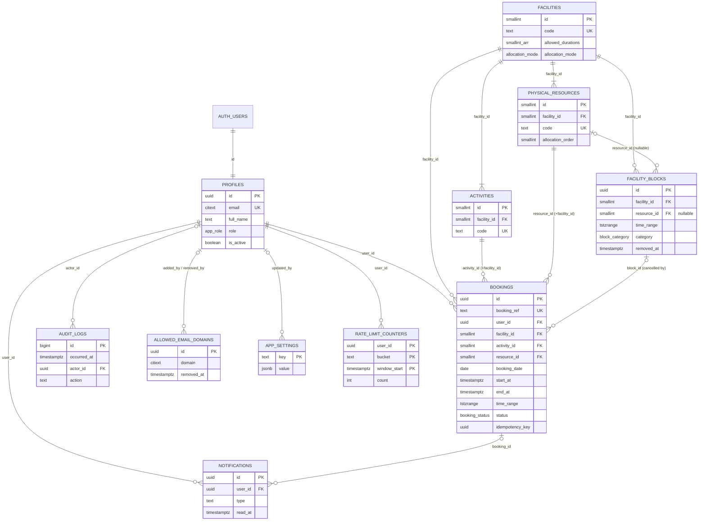

# DCU Active — Database Design

| Item | Value |
|---|---|
| Phase | Phase 1 — Solution Architecture and UX Design |
| Version | 1.0 (Draft for review) |
| Date | 2026-10-14 |
| Database | PostgreSQL (Supabase), region Southeast Asia (Singapore) |
| Related | `SOLUTION-ARCHITECTURE.md` (schema layout §3.1, security model §3.2), `API-RPC-SPECIFICATION.md`, TRD §5–8, §10 |

> The SQL in this document is **design-level DDL** for review. It becomes versioned migrations in Phase 2, where exact syntax is validated by `supabase db reset` and pgTAP. Nothing here has been executed.

> **Phase 2 implementation notes (2026-10-14):**
> - The implemented schema is in `supabase/migrations/` and is the source of truth.
> - Differences from this design are listed in `docs/PHASE-2-REPORT.md` §D:
>   - emails and domains are stored as lower-case `text` instead of `citext`;
>   - `rate_limit_counters` is not implemented (DV-01);
>   - `audit_logs.request_id` is omitted;
>   - the test clock requires a session-level `app.allow_time_override`.

---

## 1. Conventions

| Topic | Convention |
|---|---|
| Schemas | `app` (tables, not exposed), `api` (RPC functions, exposed), `private` (helpers, not exposed) |
| Keys | `uuid` (`gen_random_uuid()`) for transactional rows; `smallint identity` for small reference tables |
| Time | Instants are `timestamptz` (stored UTC). Business dates are `date` in WIB. Business timezone `Asia/Jakarta` (UTC+7, no DST). |
| Naming | snake_case; plural table names; constraints `<table>_<col>_<type>` (e.g. `bookings_no_overlap_excl`) |
| Soft state | Nothing is hard-deleted except expired notifications (retention) |
| Audit columns | `created_at`, `updated_at` (trigger `private.touch_updated_at`) |

---

## 2. Entity relationship diagram



`INTEGRITY_CHECK_RUNS` (operational, no foreign keys) is omitted from the diagram.

### 2.1 How the model meets the key rules

| Rule | Mechanism |
|---|---|
| Facility ≠ activity ≠ physical resource | Three tables. Bookings reference all three. Composite FKs guarantee the activity and resource belong to the booked facility. |
| Basketball/Futsal share one court | Facility `COURT` has 2 activities and **1** resource. Overlap is checked per resource. The daily limit is keyed by facility. |
| Pooled Air Hockey / Foosball | `allocation_mode = 'AUTO_POOL'`, 2 resources each, allocated by `allocation_order` |
| No overlap | `bookings_no_overlap_excl` GiST exclusion constraint on `(resource_id, time_range)` for occupying statuses |
| Blocks | `facility_blocks` with nullable `resource_id` (NULL = whole facility). Checked under the same resource locks as bookings. |
| History | Status changes only. `cancelled_*`, `checked_in_at`, `no_show_at`, `completed_at` columns. `audit_logs` append-only. |
| Configurable policy | `app_settings` (validated ranges) read live by every RPC |
| Domain allow-list | `allowed_email_domains` (soft-removable, ≥ 1 active) |

---

## 3. DDL (design)

### 3.1 Extensions, schemas, types

```sql
create extension if not exists btree_gist;   -- '=' on scalars inside GiST exclusion
create extension if not exists citext;
create extension if not exists pg_trgm;      -- admin search
create extension if not exists pg_cron;      -- scheduled jobs (Supabase: enable via dashboard/migration)

create schema if not exists app;
create schema if not exists api;
create schema if not exists private;

create type app.app_role        as enum ('USER', 'ADMIN');
create type app.booking_status  as enum ('CONFIRMED', 'CHECKED_IN', 'COMPLETED', 'CANCELLED', 'ADMIN_CANCELLED', 'NO_SHOW');
create type app.cancel_source   as enum ('USER', 'ADMIN', 'BLOCK', 'DEACTIVATION');
create type app.block_category  as enum ('MAINTENANCE', 'EVENT', 'OPERATIONAL', 'OTHER');
create type app.allocation_mode as enum ('SINGLE', 'AUTO_POOL');
```

### 3.2 `app.profiles`

```sql
create table app.profiles (
  id                   uuid primary key references auth.users(id) on delete restrict,
  email                citext not null unique,
  full_name            text   not null check (char_length(btrim(full_name)) between 2 and 100),
  role                 app.app_role not null default 'USER',
  is_active            boolean not null default true,
  deactivated_at       timestamptz,
  deactivated_by       uuid references app.profiles(id),
  deactivation_reason  text,
  created_at           timestamptz not null default now(),
  updated_at           timestamptz not null default now(),
  constraint profiles_deactivation_consistent check (
    (is_active and deactivated_at is null and deactivation_reason is null)
    or (not is_active and deactivated_at is not null and char_length(deactivation_reason) >= 5)
  )
);
create index profiles_name_trgm  on app.profiles using gin (full_name gin_trgm_ops);
create index profiles_email_trgm on app.profiles using gin ((email::text) gin_trgm_ops);
create index profiles_admins     on app.profiles (id) where role = 'ADMIN' and is_active;
```

### 3.3 Reference tables

```sql
create table app.facilities (
  id                 smallint generated always as identity primary key,
  code               text not null unique check (code ~ '^[A-Z_]{3,30}$'),
  name               text not null,
  description        text,
  allowed_durations  smallint[] not null
                     check (cardinality(allowed_durations) >= 1
                            and allowed_durations <@ array[30,60,90]::smallint[]),
  allocation_mode    app.allocation_mode not null,
  display_order      smallint not null unique,
  is_active          boolean not null default true
);

create table app.activities (
  id           smallint generated always as identity primary key,
  facility_id  smallint not null references app.facilities(id),
  code         text not null unique check (code ~ '^[A-Z_]{3,30}$'),
  name         text not null,
  is_active    boolean not null default true,
  unique (id, facility_id)                       -- target of composite FK
);

create table app.physical_resources (
  id                smallint generated always as identity primary key,
  facility_id       smallint not null references app.facilities(id),
  code              text not null unique check (code ~ '^[A-Z0-9_]{3,40}$'),
  name              text not null,
  allocation_order  smallint not null,
  is_active         boolean not null default true,
  unique (facility_id, allocation_order),
  unique (id, facility_id)                       -- target of composite FK
);
```

### 3.4 `app.facility_blocks`

```sql
create table app.facility_blocks (
  id              uuid primary key default gen_random_uuid(),
  facility_id     smallint not null references app.facilities(id),
  resource_id     smallint,
  start_at        timestamptz not null,
  end_at          timestamptz not null,
  time_range      tstzrange generated always as (tstzrange(start_at, end_at, '[)')) stored,
  category        app.block_category not null,
  reason          text not null check (char_length(btrim(reason)) between 5 and 500),
  created_by      uuid not null references app.profiles(id),
  created_at      timestamptz not null default now(),
  removed_at      timestamptz,
  removed_by      uuid references app.profiles(id),
  removal_reason  text,
  foreign key (resource_id, facility_id) references app.physical_resources(id, facility_id),
  check (end_at > start_at),
  check (extract(epoch from start_at)::bigint % 1800 = 0
         and extract(epoch from end_at)::bigint % 1800 = 0),   -- 30-min aligned (UTC+7 is whole hours)
  check ((removed_at is null and removed_by is null)
         or (removed_at is not null and removed_by is not null and char_length(removal_reason) >= 5))
);
create index facility_blocks_active_range on app.facility_blocks
  using gist (facility_id, time_range) where removed_at is null;
```

Operating-hours containment for each day of a multi-day block is validated in `api.admin_create_block` (it needs WIB calendar logic).

### 3.5 `app.bookings`

```sql
create table app.bookings (
  id                   uuid primary key default gen_random_uuid(),
  booking_ref          text not null unique check (booking_ref ~ '^DCU-[0-9]{6}-[A-HJ-NP-Z2-9]{4}$'),
  user_id              uuid not null references app.profiles(id),
  facility_id          smallint not null references app.facilities(id),
  activity_id          smallint not null,
  resource_id          smallint not null,
  booking_date         date not null,                       -- WIB date of start (validated by trigger)
  start_at             timestamptz not null,
  end_at               timestamptz not null,
  duration_minutes     smallint not null check (duration_minutes in (30, 60, 90)),
  time_range           tstzrange generated always as (tstzrange(start_at, end_at, '[)')) stored,
  status               app.booking_status not null default 'CONFIRMED',
  idempotency_key      uuid not null,
  checked_in_at        timestamptz,
  completed_at         timestamptz,
  no_show_at           timestamptz,
  cancelled_at         timestamptz,
  cancelled_by         uuid references app.profiles(id),
  cancel_source        app.cancel_source,
  cancellation_reason  text,
  block_id             uuid references app.facility_blocks(id),
  created_at           timestamptz not null default now(),
  updated_at           timestamptz not null default now(),

  foreign key (activity_id, facility_id) references app.activities(id, facility_id),
  foreign key (resource_id, facility_id) references app.physical_resources(id, facility_id),
  unique (user_id, idempotency_key),
  check (end_at = start_at + make_interval(mins => duration_minutes)),
  check (extract(epoch from start_at)::bigint % 1800 = 0),
  -- status ↔ column consistency
  check (status <> 'CHECKED_IN'      or checked_in_at is not null),
  check (status <> 'COMPLETED'       or (checked_in_at is not null and completed_at is not null)),
  check (status <> 'NO_SHOW'         or (no_show_at is not null and checked_in_at is null)),
  check (status not in ('CANCELLED','ADMIN_CANCELLED')
         or (cancelled_at is not null and cancel_source is not null)),
  check (status <> 'ADMIN_CANCELLED' or char_length(cancellation_reason) >= 5),
  check (status <> 'CANCELLED'       or cancel_source = 'USER'),

  -- BR-11: no overlapping occupying bookings on the same physical resource
  constraint bookings_no_overlap_excl exclude using gist (
    resource_id with =,
    time_range  with &&
  ) where (status in ('CONFIRMED', 'CHECKED_IN', 'COMPLETED'))
);
create index bookings_facility_date   on app.bookings (facility_id, booking_date);
create index bookings_user_daily      on app.bookings (user_id, facility_id, booking_date);
create index bookings_user_active     on app.bookings (user_id, end_at) where status in ('CONFIRMED','CHECKED_IN');
create index bookings_status_due      on app.bookings (status, start_at) where status in ('CONFIRMED','CHECKED_IN');
create index bookings_created_desc    on app.bookings (created_at desc);
```

**Booking reference:** `DCU-<YYMMDD of booking_date>-<4 chars from 23456789ABCDEFGHJKLMNPQRSTUVWXYZ>`. Generated in `create_booking`; retried on the (very unlikely) unique collision.

### 3.6 `app.allowed_email_domains`

```sql
create table app.allowed_email_domains (
  id              uuid primary key default gen_random_uuid(),
  domain          citext not null
                  check (domain::text = lower(domain::text)
                         and domain::text ~ '^([a-z0-9]([a-z0-9-]{0,61}[a-z0-9])?\.)+[a-z]{2,63}$'),
  added_by        uuid references app.profiles(id),      -- null for seed rows
  added_at        timestamptz not null default now(),
  removed_by      uuid references app.profiles(id),
  removed_at      timestamptz,
  removal_reason  text
);
create unique index allowed_email_domains_active_uq on app.allowed_email_domains (domain) where removed_at is null;
```

### 3.7 `app.app_settings`

```sql
create table app.app_settings (
  key          text primary key,
  value        jsonb not null,
  is_editable  boolean not null,
  min_value    integer,           -- for editable integer settings
  max_value    integer,
  description  text not null,
  updated_at   timestamptz not null default now(),
  updated_by   uuid references app.profiles(id)
);
-- trigger private.validate_setting(): editable integer keys must be integers within [min_value, max_value]
```

### 3.8 `app.notifications`, `app.audit_logs`, operational tables

```sql
create table app.notifications (
  id          uuid primary key default gen_random_uuid(),
  user_id     uuid not null references app.profiles(id),
  type        text not null check (type in ('BOOKING_CONFIRMED','BOOKING_CANCELLED','CHECKED_IN',
                                            'ADMIN_CANCELLED','NO_SHOW','ACCOUNT_DEACTIVATED')),
  title       text not null,
  body        text not null,
  booking_id  uuid references app.bookings(id),
  created_at  timestamptz not null default now(),
  read_at     timestamptz
);
create index notifications_user_recent on app.notifications (user_id, created_at desc);

create table app.audit_logs (
  id           bigint generated always as identity primary key,
  occurred_at  timestamptz not null default now(),
  actor_id     uuid references app.profiles(id),      -- null = SYSTEM
  actor_role   text not null check (actor_role in ('USER','ADMIN','SYSTEM')),
  action       text not null,
  entity_type  text not null,
  entity_id    text not null,
  before       jsonb,
  after        jsonb,
  reason       text,
  request_id   uuid
);
create index audit_logs_time   on app.audit_logs (occurred_at desc);
create index audit_logs_entity on app.audit_logs (entity_type, entity_id);
create index audit_logs_actor  on app.audit_logs (actor_id, occurred_at desc);

create table app.rate_limit_counters (       -- TR-SEC-13
  user_id       uuid not null references app.profiles(id),
  bucket        text not null,                -- e.g. 'create_booking'
  window_start  timestamptz not null,         -- truncated to the minute
  count         integer not null default 0,
  primary key (user_id, bucket, window_start)
);

create table app.integrity_check_runs (      -- TR-OPS-05
  id          bigint generated always as identity primary key,
  ran_at      timestamptz not null default now(),
  check_name  text not null,
  violations  integer not null,
  sample      jsonb
);
```

**Audit actions:**

- Admin: `BOOKING_ADMIN_CANCEL`, `BLOCK_CREATE`, `BLOCK_REMOVE`, `USER_DEACTIVATE`, `USER_ACTIVATE`, `ROLE_GRANT`, `ROLE_REVOKE`, `SETTING_UPDATE`, `DOMAIN_ADD`, `DOMAIN_RENAME`, `DOMAIN_REMOVE`.
- User/system: `BOOKING_CREATE`, `BOOKING_CANCEL`, `BOOKING_CHECKIN`, `BOOKING_NO_SHOW`, `BOOKING_COMPLETE` (system, PROPOSED: aggregated, not per row), `PROFILE_UPDATE`.

---

## 4. Status transitions (enforced by `private.enforce_booking_transition`)

| From \ To | CHECKED_IN | COMPLETED | CANCELLED | ADMIN_CANCELLED | NO_SHOW |
|---|---|---|---|---|---|
| CONFIRMED | ✔ user (window) | — | ✔ user (≥ cutoff before start) | ✔ admin / block / deactivation | ✔ system (after deadline) |
| CHECKED_IN | — | ✔ system (end passed) | — | ✔ admin (before end) | — |
| COMPLETED, CANCELLED, ADMIN_CANCELLED, NO_SHOW | terminal — no transitions | | | | |

Any other transition raises `INVALID_STATUS_TRANSITION` (an internal error, never expected from correct code; covered by TEST-45).

---

## 5. Row Level Security and grants

```sql
-- Grants: schema usage for invoker functions; read-only table privileges; no write privileges.
grant usage on schema app to authenticated;
grant select on app.profiles, app.facilities, app.activities, app.physical_resources,
                app.bookings, app.notifications, app.facility_blocks, app.audit_logs,
                app.allowed_email_domains, app.app_settings to authenticated;
revoke insert, update, delete, truncate on all tables in schema app from anon, authenticated;
revoke all on schema app, private from anon;

alter table app.profiles enable row level security;   -- … and every other app table

create policy profiles_select on app.profiles for select to authenticated
  using (id = (select auth.uid()) or (select private.is_admin()));

create policy bookings_select on app.bookings for select to authenticated
  using ((user_id = (select auth.uid()) and (select private.current_user_active()))
         or (select private.is_admin()));

create policy notifications_select on app.notifications for select to authenticated
  using (user_id = (select auth.uid()) and (select private.current_user_active()));

create policy reference_select on app.facilities for select to authenticated
  using ((select private.current_user_active()) and (is_active or (select private.is_admin())));
-- same pattern for app.activities, app.physical_resources

create policy admin_only_select on app.facility_blocks       for select to authenticated using ((select private.is_admin()));
create policy admin_only_select on app.audit_logs            for select to authenticated using ((select private.is_admin()));
create policy admin_only_select on app.allowed_email_domains for select to authenticated using ((select private.is_admin()));
create policy admin_only_select on app.app_settings          for select to authenticated using ((select private.is_admin()));
-- rate_limit_counters, integrity_check_runs: RLS on, no policies (definer functions only)
```

`private.is_admin()` = active ADMIN profile for `auth.uid()`. `private.current_user_active()` = profile exists and `is_active`. Both are `SECURITY DEFINER STABLE`, `search_path = ''`.

### 5.1 Realtime authorization (`realtime.messages`)

```sql
create policy realtime_availability_read on realtime.messages for select to authenticated
  using ( (select realtime.topic()) like 'availability:%' and (select private.current_user_active()) );

create policy realtime_user_read on realtime.messages for select to authenticated
  using ( (select realtime.topic()) = 'user:' || (select auth.uid())::text );
-- No INSERT policy: clients cannot broadcast.
```

---

## 6. Functions (inventory)

### 6.1 `private` helpers

| Function | Returns | Purpose |
|---|---|---|
| `now()` | timestamptz | Server clock with test override (Architecture §6.6) |
| `today_wib()` | date | `(private.now() at time zone 'Asia/Jakarta')::date` |
| `wib_to_instant(p_date date, p_time time)` | timestamptz | `(p_date + p_time) at time zone 'Asia/Jakarta'` |
| `setting_int(p_key text)` | integer | Typed settings read |
| `raise_business_error(p_code text, p_detail jsonb)` | void | Standard error |
| `is_admin()`, `current_user_active()`, `assert_active_user()`, `assert_admin()` | boolean / void | Authorization |
| `is_email_domain_allowed(p_email text)` | boolean | Exact, case-insensitive domain match |
| `hook_before_user_created(event jsonb)` | jsonb | Auth hook (domain check) |
| `effective_status(b app.bookings)` | text | Display status (TRD 11.5) |
| `sweep_user(p_user uuid)`, `sweep_resources(p_resource_ids smallint[])` | void | In-transaction status sweep |
| `process_booking_statuses()` | integer | Cron job |
| `purge_notifications()`, `run_integrity_checks()` | integer | Cron jobs |
| `write_audit(...)`, `notify_user(...)` | void | Shared write helpers |
| `check_rate_limit(p_bucket text, p_max int)` | void | Raises `RATE_LIMITED` |
| `new_booking_ref(p_date date)` | text | Reference generator |
| trigger functions | trigger | §6.4 of the architecture document |

### 6.2 `api` functions

The full contracts are in `API-RPC-SPECIFICATION.md`. Inventory (33 functions: 2 public, 12 user, 19 admin):

| Group | Functions |
|---|---|
| Public | `get_registration_domains`, `health` |
| User | `get_my_profile`, `update_my_profile`, `get_app_config`, `list_facilities`, `get_availability`, `create_booking`, `list_my_bookings`, `get_my_booking`, `cancel_my_booking`, `check_in`, `list_my_notifications`, `mark_notifications_read` |
| Admin | `admin_dashboard_metrics`, `admin_list_bookings`, `admin_get_booking`, `admin_cancel_booking`, `admin_preview_block`, `admin_create_block`, `admin_remove_block`, `admin_list_blocks`, `admin_list_users`, `admin_get_user`, `admin_set_user_active`, `admin_set_user_role`, `admin_get_settings`, `admin_update_setting`, `admin_list_email_domains`, `admin_add_email_domain`, `admin_rename_email_domain`, `admin_remove_email_domain`, `admin_list_audit_logs` |

---

## 7. Seed / reference data (migration, idempotent)

### 7.1 Facilities, activities, resources

| Facility code | Name | Durations | Mode | Order | Activities (code — name) | Resources (code — name, order) |
|---|---|---|---|---|---|---|
| `TENNIS` | Tennis Court | {30,60,90} | SINGLE | 1 | `TENNIS` — Tennis | `TENNIS_COURT_1` — Tennis Court 1 (1) |
| `COURT` | Basketball / Futsal Court | {30,60,90} | SINGLE | 2 | `BASKETBALL` — Basketball; `FUTSAL` — Futsal | `MULTI_COURT_1` — Multipurpose Court 1 (1) |
| `TABLE_TENNIS` | Table Tennis | {30} | SINGLE | 3 | `TABLE_TENNIS` — Table Tennis | `TABLE_TENNIS_1` — Table Tennis 1 (1) |
| `FOOTBALL` | Football Field | **{30,60,90}** (OD-19) | SINGLE | 4 | `FOOTBALL` — Football | `FOOTBALL_FIELD_1` — Football Field 1 (1) |
| `AIR_HOCKEY` | Air Hockey | {30} | AUTO_POOL | 5 | `AIR_HOCKEY` — Air Hockey | `AIR_HOCKEY_1` — Air Hockey Table 1 (1); `AIR_HOCKEY_2` — Air Hockey Table 2 (2) |
| `FOOSBALL` | Foosball | {30} | AUTO_POOL | 6 | `FOOSBALL` — Foosball | `FOOSBALL_1` — Foosball Table 1 (1); `FOOSBALL_2` — Foosball Table 2 (2) |

### 7.2 Settings

| Key | Value | Editable | Range |
|---|---|---|---|
| `timezone` | `"Asia/Jakarta"` | no | — |
| `slot_minutes` | 30 | no | — |
| `operating_open` | `"06:00"` | no | — |
| `operating_close` | `"21:00"` | no | — |
| `booking_horizon_days` | 7 | yes | 0–30 |
| `max_active_bookings` | 2 | yes | 1–10 |
| `max_bookings_per_facility_per_day` | 1 | yes | 1–5 |
| `checkin_open_before_minutes` | 15 | yes | 0–60 |
| `checkin_close_after_minutes` | 15 | yes | 5–60 |
| `user_cancel_cutoff_minutes` | 30 | yes | 0–240 |
| `notification_retention_days` | 90 | no | — |
| `rate_limit_create_booking_per_min` | 20 | no | — |

### 7.3 Allowed email domains

`danamon.co.id`, `adira.co.id`, `homecredit.co.id` (`added_by` = NULL, seeded).

### 7.4 Not seeded by migration

- **Users and admins.** Admins register like everyone else (with an `@danamon.co.id` address) and are promoted by `scripts/provision-admin.sql` (TR-AUTH-10).
- **Test users** exist only in `supabase/seed.sql` (local) and the staging seed script.

---

## 8. Migration plan (Phase 2)

| # | Migration | Contents |
|---|---|---|
| 0001 | `extensions_and_schemas` | Extensions, schemas, enum types, exposed-schema notes |
| 0002 | `reference_tables` | facilities, activities, physical_resources + seed |
| 0003 | `profiles_and_auth_triggers` | profiles, auth.users triggers |
| 0004 | `settings_and_domains` | app_settings (+ validation trigger, seed), allowed_email_domains (+ seed) |
| 0005 | `bookings_and_blocks` | facility_blocks, bookings, exclusion constraint, transition trigger |
| 0006 | `notifications_audit_ops` | notifications, audit_logs (+ immutability trigger), rate_limit_counters, integrity_check_runs |
| 0007 | `private_helpers` | private functions (auth, time, errors, sweep, audit, notify) |
| 0008 | `rls_and_grants` | RLS enable + policies, grants/revokes |
| 0009 | `api_user_functions` | user-facing RPCs |
| 0010 | `api_admin_functions` | admin RPCs |
| 0011 | `realtime` | broadcast triggers + realtime.messages policies |
| 0012 | `auth_hook` | before-user-created hook function + grants to `supabase_auth_admin` |
| 0013 | `cron_jobs` | pg_cron schedules |

Each migration has matching pgTAP tests under `supabase/tests/`.

---

## 9. Data integrity checks (daily, TR-OPS-05)

| Check | Violation query (concept) | Expected |
|---|---|---|
| `overlap` | Self-join of occupying bookings on the same resource with `time_range &&` | 0 (impossible by constraint; defence in depth) |
| `outside_hours` | Bookings whose WIB start < 06:00 or WIB end > 21:00 | 0 |
| `over_active_limit` | Users with more active/future bookings than the setting **at creation time** | 0 (note: lowering the setting later can legitimately create excess; reported as informational) |
| `overdue_confirmed` | CONFIRMED bookings past their check-in deadline by > 5 min | 0 (job health) |
| `orphan_profiles` | `auth.users` without profile or vice versa | 0 |
| `no_active_admin` | Count of active admins = 0 | must be ≥ 1 |
| `no_active_domain` | Count of active domains = 0 | must be ≥ 1 |

---

## 10. Retention

| Data | Retention | Mechanism |
|---|---|---|
| Notifications | 90 days | `purge-notifications` job (only data that is hard-deleted) |
| Bookings, blocks, audit logs, profiles | ≥ 2 years (OD-17 pending legal confirmation) | Kept. An archival/anonymisation procedure is defined in the Operations Guide (Phase 6). |
| Rate-limit counters | 1 day | Purged by the same daily job |
| Integrity check runs | 90 days | Purged by the same daily job |
