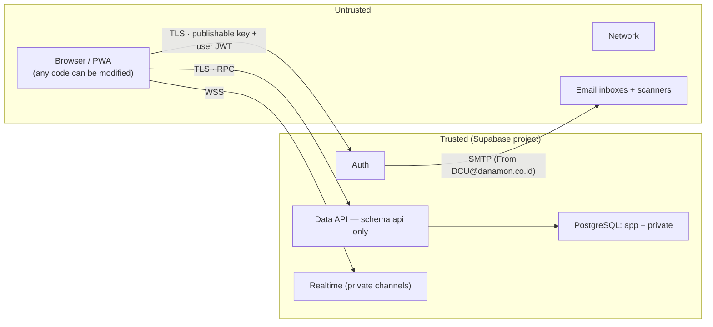

# DCU Active — Security Design

| Item | Value |
|---|---|
| Phase | Phase 1 — Solution Architecture and UX Design |
| Version | 1.0 (Draft for review) |
| Date | 2026-10-14 |
| Related | TRD §9, §10, §14; `SOLUTION-ARCHITECTURE.md`; `DATABASE-DESIGN.md` §5 |

---

## 1. Security objectives

1. Only verified, active employees of the allowed companies can use the system.
2. Users see only their own bookings and personal data. Availability never reveals who booked.
3. Only active administrators can perform administrative actions, and every such action is audited.
4. Business rules (no double booking, fair-use limits) cannot be bypassed through the API.
5. No privileged secret ever reaches the browser.
6. Deactivation, role, domain, and settings changes take effect immediately.

---

## 2. Assets and data classification

| Asset | Classification | Location |
|---|---|---|
| User identity: name, corporate email | **Personal data** (UU PDP) | `auth.users`, `app.profiles` |
| Password hashes, sessions, refresh tokens | **Secret** | Supabase Auth (managed) |
| Booking records (who / when / where) | **Personal data** (behavioural) | `app.bookings` |
| Audit logs (admin actions, reasons) | Internal, personal data | `app.audit_logs` |
| Availability (aggregate) | Internal, non-personal | computed |
| Settings, domains | Internal | `app.app_settings`, `app.allowed_email_domains` |
| Supabase secret key, DB password, SMTP credentials, CI tokens | **Secret** | Supabase dashboard, CI secret store only |
| Supabase publishable key, project URL | Public by design | SPA bundle |

---

## 3. Trust boundaries



Everything coming from the browser is untrusted: arguments, timing, number of requests, and even the absence of the UI. The database validates every input as if it came from an attacker.

---

## 4. Threat model (STRIDE)

| # | Threat | Category | Mitigation | Verified by |
|---|---|---|---|---|
| T-01 | Attacker registers with a non-company email | Spoofing | Before-User-Created hook domain check (server); exact match; email verification required | TEST-52 |
| T-02 | Credential stuffing / brute force | Spoofing | Auth rate limits; strong password policy; optional CAPTCHA (TR-AUTH-05); generic error messages | TEST-51, config review |
| T-03 | Email security scanner consumes the verification/reset link | Spoofing / DoS | Link opens a page that requires an explicit click before `verifyOtp`; a 6-digit code alternative | TEST-49 |
| T-04 | Session theft via XSS | Spoofing / Info disclosure | Strict CSP (no inline script, no third-party script origins); React escaping; `react/no-danger` lint; no HTML rendering of user text | TEST-47 (XSS case), CSP check |
| T-05 | User reads another user's bookings via direct API | Info disclosure | Tables not exposed; INVOKER read RPCs under RLS; `BOOKING_NOT_FOUND` for foreign ids | TEST-23 |
| T-06 | Availability or Realtime leaks booker identity | Info disclosure | Aggregate-only outputs; Realtime payload `{facility_code, date_wib}`; private channels | TEST-42 |
| T-07 | User calls admin RPCs | Elevation of privilege | `private.assert_admin()` on live DB state + RLS admin policies | TEST-24 |
| T-08 | User sets own role or active flag | Elevation of privilege | No table write grants; no RPC accepts role/status for self; admin RPC forbids self-modification | TEST-40 |
| T-09 | Deactivated user keeps acting with a valid JWT | Elevation of privilege | Every RPC and RLS policy checks `is_active` live; optional Auth session revocation | TEST-25 |
| T-10 | Race conditions bypass limits or double-book | Tampering | Profile/resource row locks; exclusion constraint; idempotency keys | TEST-07…14, 26, 34 |
| T-11 | Tampered request (past time, wrong duration, foreign facility/resource) | Tampering | Server derives times from date + time in WIB; validates everything; composite FKs | TEST-15, 16, 34 |
| T-12 | Admin abuses power without trace | Repudiation | Mandatory reason + append-only audit logs (immutable trigger) | TEST-33 |
| T-13 | SQL injection via RPC arguments | Tampering | Parameterised PL/pgSQL; no dynamic SQL built from input (any `EXECUTE` uses `format('%I/%L')`) | Code review checklist, pgTAP |
| T-14 | `search_path` hijacking of SECURITY DEFINER functions | Elevation of privilege | `SET search_path = ''`; fully qualified names; Security Advisor | pgTAP lint test |
| T-15 | Secret key leaked in the frontend bundle or repo | Info disclosure | Only `VITE_*` public vars; `.gitignore`; CI bundle scan; secret scanning on GitHub | TEST-35 |
| T-16 | Open redirect after login/reset | Spoofing | `safeNext()` allow-list; Supabase redirect URL allow-list | TEST-50 |
| T-17 | Clickjacking | Tampering | `frame-ancestors 'none'`, `X-Frame-Options: DENY` | Header check |
| T-18 | Booking spam / resource exhaustion | DoS | Per-user rate limit on `create_booking`; fair-use limits; Auth rate limits | Test + config |
| T-19 | Malicious admin settings (e.g. horizon 0) | Tampering / DoS | Server-side ranges; reason + audit; read-only critical keys | TEST-54 |
| T-20 | Domain list emptied → nobody can register | DoS | ≥ 1 active domain safeguard | TEST-53 |
| T-21 | Spoofed emails "from DCU" (phishing users) | Spoofing | SPF/DKIM/DMARC for `danamon.co.id` sender (OD-03); emails contain no links except to the official domain | Mail config review |
| T-22 | Test clock abused in production | Tampering | `private.now()` honours overrides only if `app.allow_time_override = on`, which is never set in production; deployment check | Deployment checklist |

---

## 5. Authentication configuration (per environment)

| Setting | Value |
|---|---|
| Providers | Email only (others disabled) |
| Allow new sign-ups | On |
| Confirm email | **On** |
| Before-User-Created hook | `private.hook_before_user_created` (domain allow-list) |
| Minimum password length | 8 |
| Password requirements | Lowercase, uppercase, digits, and symbols |
| Leaked password protection | On if the plan supports it |
| OTP / link expiry | 3600 s (≤ 60 min) |
| JWT expiry | 3600 s |
| Refresh-token rotation + reuse detection | On |
| Session time-box / inactivity timeout (if plan supports) | 30 days / 7 days |
| Site URL / Redirect URLs | Exact origins per environment: `/auth/confirm`, `/reset-password` |
| SMTP | Custom; sender `DCU@danamon.co.id`, name "DCU Active" (OD-03 method) |
| Email templates | Confirm signup and Reset password: code + scanner-safe link. Magic link and email change are disabled or not used. |
| Secure email change | Not used in V1 (email change disabled in the UI) |

---

## 6. Authorization model

| Decision point | Check | Source of truth |
|---|---|---|
| Is the caller authenticated? | `auth.uid()` not null | JWT signature (Supabase) |
| Is the caller active? | `app.profiles.is_active` | Database (live) |
| Is the email verified? | `auth.users.email_confirmed_at` not null | Database (live) |
| Is the caller an admin? | `app.profiles.role = 'ADMIN' and is_active` | Database (live) |
| Does the caller own the booking? | `bookings.user_id = auth.uid()` | RLS + function check |
| Is the email domain allowed? | `app.allowed_email_domains` | Database (live), at sign-up and admin grant |

JWT custom claims are **not** used for authorization (ADR-006).

---

## 7. Database function security checklist (enforced in code review and pgTAP)

1. `SECURITY DEFINER` functions declare `SET search_path = ''` and use schema-qualified names.
2. EXECUTE is revoked from `public` and `anon`, then granted explicitly (`authenticated`; `anon` only for `get_registration_domains`, `health`).
3. The first statement authenticates and authorizes (`private.assert_active_user()` / `private.assert_admin()`).
4. Inputs are validated for type, range, and format before use. Text lengths are bounded.
5. No dynamic SQL from input. If unavoidable, use `format()` with `%I`/`%L`.
6. Errors go through `private.raise_business_error`. No database internals appear in messages.
7. Mutations write their audit row in the same transaction.
8. Outputs of DEFINER read functions are reviewed for personal data (privacy test).
9. Lock order follows Architecture §6.2.
10. A pgTAP "lint" test fails if any `api` function lacks a fixed `search_path` or grants EXECUTE to `public`.

---

## 8. Frontend security

### 8.1 Security headers (host config; staging starts with CSP in Report-Only)

```
Content-Security-Policy: default-src 'self'; script-src 'self'; style-src 'self';
  img-src 'self' data: blob:; font-src 'self';
  connect-src 'self' https://<ref>.supabase.co wss://<ref>.supabase.co https://<sentry-ingest-host>;
  manifest-src 'self'; worker-src 'self'; frame-ancestors 'none'; base-uri 'self';
  form-action 'self'; object-src 'none'; upgrade-insecure-requests
Strict-Transport-Security: max-age=31536000; includeSubDomains
X-Content-Type-Options: nosniff
X-Frame-Options: DENY
Referrer-Policy: strict-origin-when-cross-origin
Permissions-Policy: camera=(), microphone=(), geolocation=(), payment=(), usb=()
Cross-Origin-Opener-Policy: same-origin
```

- Tailwind 4 emits static CSS files, and the system font stack needs no font host, so `style-src 'self'` is achievable.
- If a library requires inline styles, use CSP hashes rather than `'unsafe-inline'`.
- The Sentry host is added only if OD-08 selects Sentry.

### 8.2 Other frontend controls

- Session storage is handled by supabase-js (localStorage, PKCE flow). XSS is the main risk to it, hence the strict CSP.
- No secrets in `VITE_*` variables. The CI script `scripts/bundle-secret-scan.mjs` fails the build if `dist/` contains `sb_secret_`, `service_role`, or a JWT whose role is not `anon`.
- `safeNext()` accepts only relative paths matching known routes, and rejects `//`, `\`, schemes, and encoded variants.
- Monitoring `beforeSend` scrubs emails, names, and tokens from events and URLs.

---

## 9. Email security (sender `DCU@danamon.co.id`)

| Control | Requirement |
|---|---|
| SPF | `danamon.co.id` SPF authorises the sending infrastructure (Danamon relay or provider) |
| DKIM | Mail signed with a DKIM key published under `danamon.co.id` (aligned) |
| DMARC | Danamon's existing DMARC policy must pass via aligned SPF or DKIM |
| Content | Plain, branded "DCU Active" emails; code shown in the body; link only to the official app domain; no tracking pixels |
| Recipient side | Allow-list request to the IT of Danamon, Adira, Home Credit (TR-R13) |
| Abuse | Auth email rate limits; resend cooldown in the UI (60 s) |

---

## 10. Privacy (UU PDP — Law No. 27 of 2022)

| Topic | Design |
|---|---|
| Data minimisation | Only name, corporate email, bookings, and notifications are stored. No phone, photo, location, or device fingerprint. |
| Purpose | Facility booking and fair-use administration only |
| Transparency | Short privacy notice linked on the registration and profile screens (text to be approved by Legal, OD-17) |
| Access control | Own data for users; admins see what they need for operations; all admin views are audited where they change data |
| Cross-border transfer | Data stored in Singapore. The PO confirmed overseas storage is allowed (OD-22). Legal to confirm the notice wording. |
| Retention | Bookings/audit ≥ 2 years (pending OD-17); notifications 90 days |
| Data subject requests | V1: handled by an admin through a documented procedure (export or anonymise profile), Operations Guide (Phase 6) |
| Third parties | Supabase (processor), host/CDN, email provider, monitoring (no PII). The processor list goes into the privacy notice. |

---

## 11. Audit design

- **Immutable:** a `BEFORE UPDATE OR DELETE` trigger raises an error, and no role has write grants.
- **Content:** actor, role, time (UTC; displayed in WIB), action, entity, before/after (minimal), reason, request id.
- **Coverage:** all admin mutations (mandatory) and user booking lifecycle events.
- **Access:** admins read via `admin_list_audit_logs`.

---

## 12. Security testing plan (summary; details in `TEST-PLAN.md`)

| Activity | When |
|---|---|
| pgTAP privilege tests per role (anon, user A/B, deactivated, admin) | Phase 2, every CI run |
| Function lint test (search_path, grants) | Phase 2, every CI run |
| Concurrency abuse tests | Phase 2 / 4 |
| Bundle secret scan, dependency audit | Every CI run |
| Supabase Security Advisor review | End of Phase 2 and before production |
| OWASP ZAP baseline scan against staging | Phase 4 |
| Manual review of auth flows, RLS, RPCs, headers | Phase 4 |
| Go-live gate: no open Critical/High findings | Phase 5 |

---

## 13. Incident response (outline for the Operations Guide)

1. **Detect.** Monitoring alerts, integrity check failures, or a user report.
2. **Contain.** Deactivate the affected accounts. Remove the affected domain. Rotate keys (Supabase secret key, SMTP credentials). Block a facility if needed.
3. **Investigate.** Audit logs, Supabase logs.
4. **Recover.** Restore from backup if data was corrupted (OD-09).
5. **Notify.** Follow the UU PDP notification obligations through DCU's DPO/Legal.
6. **Review.** Post-incident review and backlog actions.
