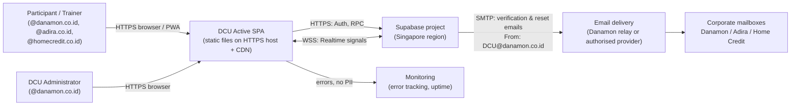
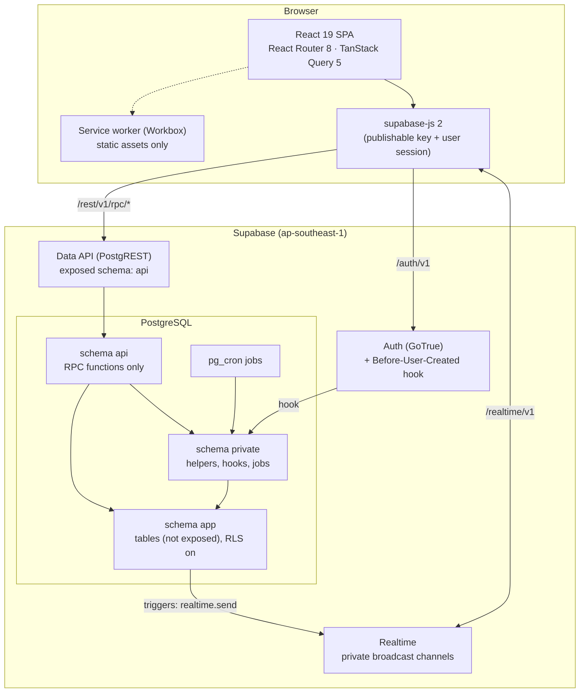
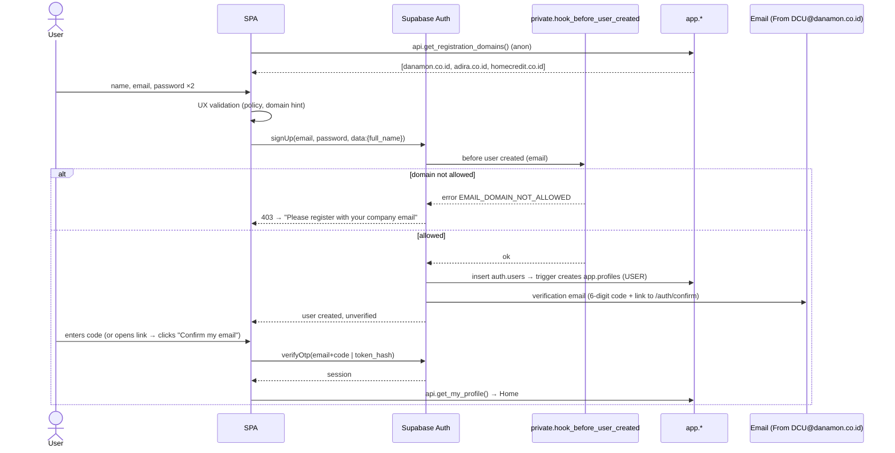
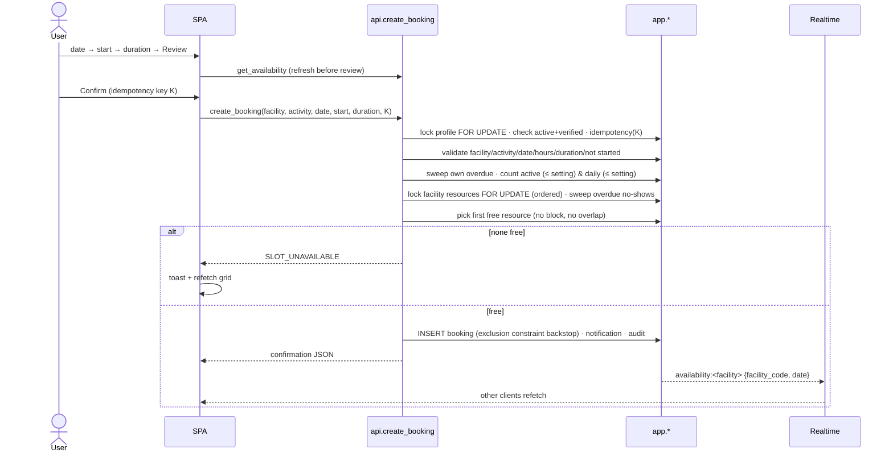
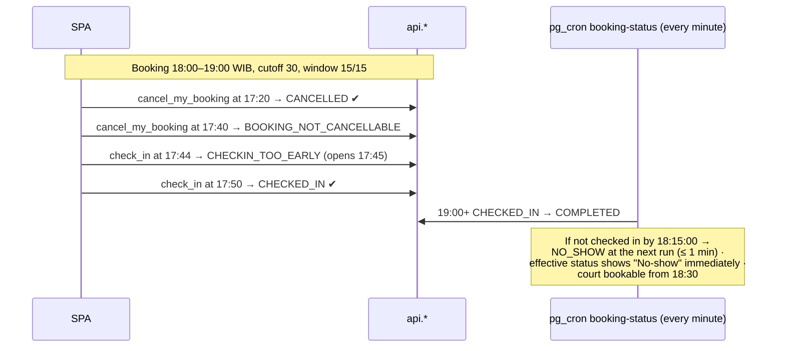
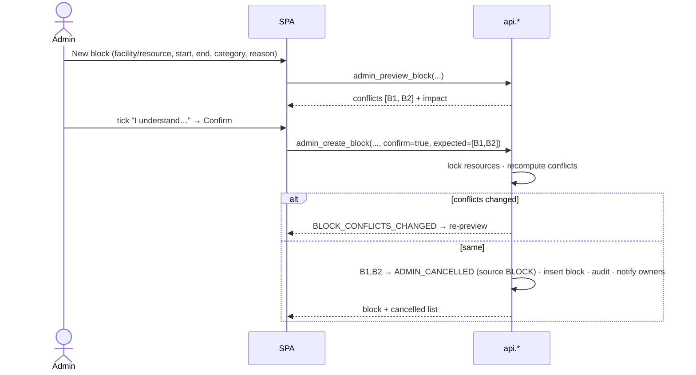
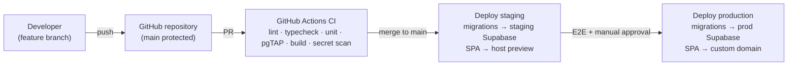

# DCU Active — Solution Architecture

| Item | Value |
|---|---|
| Phase | Phase 1 — Solution Architecture and UX Design |
| Version | 1.0 (Draft for review) |
| Date | 2026-10-14 |
| Inputs | `docs/requirements/BRD.md` v0.2, `TRD.md` v0.2, `OPEN-DECISIONS.md` v0.3 |
| Related | `DATABASE-DESIGN.md`, `API-RPC-SPECIFICATION.md`, `SECURITY-DESIGN.md`, `../design/UX-UI-SPECIFICATION.md`, `../testing/TEST-PLAN.md` |

This document turns the TRD into a buildable design. Where it refines the TRD, the refinement is flagged **[Refines TRD]** so reviewers can see what changed and why.

---

## 1. Scope and goals

DCU Active is a responsive single-page web application (with PWA support) for booking DCU sports facilities.

The architecture must guarantee:

1. no double booking (BR-11, BR-20);
2. server-side enforcement of every business rule (BR-15);
3. privacy of booking owners (SEC-05);
4. immediate effect of deactivation, role, domain, and settings changes (SEC-19, FR-ADM-12/13);
5. a simple, fast mobile experience for occasional users (FR-UX-02).

---

## 2. System context



| External system | Purpose | Decision |
|---|---|---|
| Supabase (Auth, PostgreSQL, Realtime, cron) | Identity, data, business logic, live signals | APPROVED stack; region Singapore (OD-22) |
| Static HTTPS host + CDN | Serves the SPA and security headers | Host-agnostic design; provider = OD-01 (default Cloudflare Pages) |
| Email delivery for `DCU@danamon.co.id` | Verification and password-reset emails | Sender decided; method pending Danamon IT (OD-03, §11) |
| Monitoring | Frontend errors and uptime | OD-08 (default Sentry + uptime monitor) |

---

## 3. Container view



### 3.1 Schema layout **[Refines TRD]**

| Schema | Exposed to the Data API? | Contents | Why |
|---|---|---|---|
| `api` | **Yes (the only exposed schema)** | RPC functions only. No tables or views. | The public surface is exactly the reviewed function list, so new tables can never leak by accident. |
| `app` | No | All business tables (`profiles`, `bookings`, …) with RLS enabled | Tables are reachable only through functions. Direct REST access is impossible. |
| `private` | No | Helper functions (`is_admin`, `now_wib`, error helpers), the Auth hook, scheduled jobs, trigger functions | Never callable by clients. |
| `public` | Not exposed (removed from "Exposed schemas") | Empty except extensions if required | Prevents accidental exposure. |

The TRD assumed tables in an exposed schema protected by RLS. Moving tables to a non-exposed schema keeps RLS (defence in depth) but removes the direct table API entirely. All TRD requirements still hold.

### 3.2 Function security model **[Refines TRD]**

| Function type | Security mode | Rationale |
|---|---|---|
| **Own-data reads** (`list_my_bookings`, `get_my_booking`, `get_my_profile`, `list_my_notifications`) | `SECURITY INVOKER`. Runs as `authenticated`, so **RLS filters the rows**. | RLS is the real authority for "own rows only" (SEC-03). A bug in the function's WHERE clause cannot leak data. |
| **Admin reads** (`admin_list_*`, `admin_get_*`, `admin_dashboard_metrics`) | `SECURITY INVOKER` + RLS admin policies + explicit `private.assert_admin()` | Two independent checks. |
| **Aggregated public reads** (`get_availability`, `list_facilities`, `get_app_config`, `get_registration_domains`) | `SECURITY DEFINER`, returning **aggregates only** | Must count other users' bookings without exposing them (SEC-05). Output contract reviewed in tests (TEST-42). |
| **All writes** (`create_booking`, `cancel_my_booking`, `check_in`, all `admin_*` mutations) | `SECURITY DEFINER`, `SET search_path = ''`, explicit authorization at the top | Writes need cross-row validation and locking that RLS cannot express. The `authenticated` role has **no** INSERT/UPDATE/DELETE grants on `app` tables. |

---

## 4. Environments and configuration

| Environment | Frontend | Supabase | Email | Data |
|---|---|---|---|---|
| **Local** (developer PC) | `vite dev` on `http://localhost:5173` | Supabase CLI local stack (Docker) | Inbucket/Mailpit (local mail catcher, built into the CLI) | `supabase/seed.sql` test data |
| **Staging** | Host preview URL (HTTPS) | Separate Supabase project, Singapore | Real delivery from `DCU@danamon.co.id` (once OD-03 is resolved) | Synthetic test users; UAT accounts |
| **Production** | Custom domain (OD-02), HTTPS | Separate Supabase project, Singapore, paid plan (OD-09) | Real delivery | Real users only |

**Frontend environment variables** (public by design, embedded at build time):

| Variable | Example |
|---|---|
| `VITE_SUPABASE_URL` | `https://<ref>.supabase.co` |
| `VITE_SUPABASE_PUBLISHABLE_KEY` | `sb_publishable_…` |
| `VITE_APP_ENV` | `local` \| `staging` \| `production` |
| `VITE_SENTRY_DSN` | optional |

**Server-side secrets** — SMTP credentials, the Supabase secret key, and the CI access token — live only in the Supabase dashboard and CI secret store. They never appear in `VITE_*` variables (SEC-06).

**Database-level settings per environment:**

| Setting | Local / staging | Production |
|---|---|---|
| `app.allow_time_override` | `on` (enables the test clock, §6.6) | **Must not be set** |

---

## 5. Frontend architecture

### 5.1 Selected libraries (pinned in Phase 2; versions checked on npm 2026-10-14)

| Concern | Library | Version | Notes |
|---|---|---|---|
| UI runtime | `react`, `react-dom` | 19.3.0 | |
| Language | `typescript` | **6.0.3** | `typescript-eslint` 8.71.2 supports TS < 6.1 (ADR-008) |
| Build | `vite` 8.3.4, `@vitejs/plugin-react` 6.1.2 | | |
| Routing | `react-router` | 8.4.0 | Data router (`createBrowserRouter`); data loading is done by React Query, not route loaders |
| Server state | `@tanstack/react-query` | 5.104.2 | |
| Backend client | `@supabase/supabase-js` | 2.117.3 | `db.schema = 'api'`, `auth.flowType = 'pkce'` |
| Styling | `tailwindcss` + `@tailwindcss/vite` | 4.3.3 | Peer: vite ^5–^8 ✔ |
| Accessible primitives | `radix-ui` | 1.8.1 | Dialog, Sheet, Tabs, Toast, Select, Tooltip |
| Icons | `lucide-react` | 1.56.0 | |
| Forms & validation | `react-hook-form` 7.90.0, `@hookform/resolvers` 5.9.1, `zod` 4.6.7 | | UX-only validation |
| PWA | `vite-plugin-pwa` 2.0.0, `workbox-window` 7.4.1 | | |
| Error monitoring (OD-08) | `@sentry/react` | 11.7.0 | Peer supports react-router 8 ✔ |
| Tests | `vitest` 5.0.4, `@testing-library/react` 16.3.3, `jsdom` 30.1.2, `msw` 3.0.3, `@playwright/test` 1.64.0, `@axe-core/playwright` 4.13.0 | | |

### 5.2 Source structure (planned for Phase 3)

```
src/
  app/                 router.tsx, providers.tsx (QueryClient, Auth, Realtime), layouts/
  features/
    auth/              Login, Register, Verify, AuthConfirm, ForgotPassword, ResetPassword, AccountDisabled
    home/              Home (upcoming booking, check-in banner, facility tiles)
    facilities/        FacilityList, FacilityBooking (date strip + slot grid + duration), ReviewSheet
    bookings/          MyBookings (Upcoming | History), BookingDetail, BookingConfirmed
    notifications/     NotificationList, unread badge
    profile/           Profile, ChangePassword
    admin/             dashboard/, bookings/, blocks/, users/, settings/ (Booking settings | Email domains), audit/
  components/ui/       design-system components (Button, Sheet, SlotCell, DateStrip, StatusBadge, …)
  lib/
    supabase.ts        single client instance
    api/               typed RPC wrappers (one file per feature), generated DB types
    errors.ts          business error code → message map
    time.ts            WIB formatting helpers (Intl, timeZone 'Asia/Jakarta')
    realtime.ts        channel manager (subscribe/unsubscribe, status → polling fallback)
    safe-redirect.ts   safeNext() allow-list
  pwa/                 registration, update prompt, offline detector
  styles/              tokens.css (CSS variables from UX spec), tailwind entry
tests/                 unit/ (Vitest), e2e/ (Playwright), a11y/
supabase/              migrations/, tests/ (pgTAP), seed.sql, config.toml
scripts/               provision-admin.sql, bundle-secret-scan.mjs, concurrency/ harness
```

### 5.3 Routing and guards

| Guard | Applies to | Behaviour |
|---|---|---|
| `PublicOnly` | `/login`, `/register`, `/verify`, `/forgot-password` | Signed-in user → redirect to `/` |
| `RequireSession` | everything except public routes and `/auth/confirm`, `/reset-password` | No session → `/login?next=<safe path>` |
| `RequireActive` | user and admin routes | Calls `get_my_profile`. If `is_active = false` → `/account-disabled` |
| `RequireAdmin` | `/admin/**` | Role ≠ ADMIN → Not-found page (does not reveal that admin routes exist). Backend checks regardless. |

The admin route tree is **lazy-loaded** into a separate chunk, so normal users never download admin code (TR-PERF-02).

### 5.4 Server-state strategy (TanStack Query)

| Query key | Source RPC | `staleTime` | Refetch |
|---|---|---|---|
| `['config']` | `get_app_config` | 5 min | on focus |
| `['facilities']` | `list_facilities` | 1 h | — |
| `['availability', facilityCode, date]` | `get_availability` | 15 s | Realtime signal; focus; reconnect; 30 s polling when Realtime is down; always before opening the review sheet |
| `['my-bookings', 'upcoming' \| 'history']` | `list_my_bookings` | 30 s | after any booking mutation; at status boundaries (check-in opens/closes, cancel cutoff) |
| `['booking', id]` | `get_my_booking` | 30 s | as above |
| `['notifications']` | `list_my_notifications` | 60 s | user Realtime topic |
| `['admin', …]` | admin RPCs | 30 s | after admin mutations |

Mutation rules:

- `networkMode: 'online'` for all mutations, so nothing is queued offline (TR-PWA-04).
- No query persistence to storage.
- `create_booking` uses an **idempotency key** generated when the review sheet opens (`crypto.randomUUID()`) and reused for retries of that same review (FR-BKG-05).

### 5.5 Time handling

- The server returns instants as ISO-8601 UTC **and** pre-formatted WIB strings (`date_wib`, `start_wib`, `end_wib`). The UI displays the WIB strings or formats with `Intl.DateTimeFormat('en-GB', { timeZone: 'Asia/Jakarta' })`. All displayed times carry the "WIB" suffix.
- The "today" used for the date strip comes from `get_app_config().today_wib`, not the device clock (TEST-27).
- Client timers only refresh labels and trigger refetches. Actions are always re-validated by the server.

### 5.6 Error handling

- RPC errors arrive as PostgREST errors with `message = <BUSINESS_CODE>` and `details = <JSON>` (see `API-RPC-SPECIFICATION.md` §2).
- `lib/errors.ts` maps codes to plain-English copy (UX spec §9).
- An unknown error shows "Something went wrong. Reference: {id}" and is reported to monitoring without personal data.
- A React error boundary per route shows the Error state with a "Try again" action.

### 5.7 Realtime client

- After sign-in, the client subscribes to the private channel `availability:<facility_code>` **only while that facility's booking screen is open**, and to `user:<uid>` for the session.
- Channel status `SUBSCRIBED` disables polling. Any other status enables 30-second polling for the open screen (TR-RT-05).

### 5.8 PWA and offline

- `vite-plugin-pwa` with `registerType: 'prompt'` and `generateSW`.
- Precache build assets only. `NetworkOnly` for the Supabase origin.
- `navigateFallback: '/index.html'` with a deny-list for `/auth/confirm` so email links always reach the network.
- The offline banner and disabled action buttons are driven by an `useOnlineStatus` hook (`navigator.onLine` + events + failed-fetch detection).
- The update prompt is deferred while the booking review sheet is open.

---

## 6. Backend architecture

### 6.1 Function conventions

| Convention | Rule |
|---|---|
| Naming | `api.<verb>_<noun>` for client RPCs; `private.<name>` for internals; admin RPCs prefixed `admin_` |
| Arguments | Prefixed `p_`; business-level types (e.g. `p_date date`, `p_start_time text 'HH:MM'`) |
| Return | `jsonb` (single object) or `SETOF`/`jsonb` arrays for lists, with stable field names (API spec) |
| Errors | `perform private.raise_business_error('<CODE>', jsonb_build_object(...))` → `RAISE EXCEPTION USING ERRCODE = 'P0001', MESSAGE = code, DETAIL = json` |
| Security | Definer functions: `SECURITY DEFINER SET search_path = ''`, fully-qualified names, owner = `postgres` |
| Grants | `REVOKE ALL ON FUNCTION … FROM public, anon`; `GRANT EXECUTE … TO authenticated` (exception: `get_registration_domains` → `anon` too) |
| Timeouts | Mutations: `SET LOCAL lock_timeout = '3s'`, `statement_timeout = '10s'` → mapped to `SYSTEM_BUSY` |
| Clock | All "now" comes from `private.now()` (§6.6) |

### 6.2 Lock ordering (deadlock avoidance, TR-CON-06)

```
1. app.profiles (requesting user)            -- FOR UPDATE   (booking, check-in, cancel)
2. app.physical_resources of the facility    -- FOR UPDATE, ORDER BY allocation_order
3. app.bookings rows                         -- FOR UPDATE   (cancel, check-in, conflicts)
Admin role/activation changes: lock all ADMIN profiles ORDER BY id (last-admin check), then the target.
Status processor: bookings FOR UPDATE SKIP LOCKED (never waits).
```

### 6.3 Scheduled jobs (`pg_cron`)

| Job | Schedule (UTC cron) | Function | Purpose |
|---|---|---|---|
| `booking-status` | `* * * * *` (every minute) | `private.process_booking_statuses()` | CONFIRMED → NO_SHOW after the deadline; CHECKED_IN → COMPLETED after end |
| `purge-notifications` | `0 20 * * *` (03:00 WIB) | `private.purge_notifications()` | Retention (90 days) |
| `integrity-check` | `15 20 * * *` (03:15 WIB) | `private.run_integrity_checks()` | Writes results to `app.integrity_check_runs`; monitoring alerts on failures (TR-OPS-05) |

### 6.4 Triggers

| Table | Trigger | Purpose |
|---|---|---|
| `auth.users` AFTER INSERT | `private.on_auth_user_created` | Create `app.profiles` (role USER, full name from sign-up metadata) |
| `auth.users` AFTER UPDATE OF email | `private.on_auth_user_email_changed` | Keep `profiles.email` in sync (email change is disabled in V1, defensive only) |
| `app.bookings` BEFORE UPDATE | `private.enforce_booking_transition` | Allowed status transitions only (TR-BKG-09) |
| `app.bookings` AFTER INSERT/UPDATE OF status | `private.broadcast_availability_change` | `realtime.send` to `availability:<code>` |
| `app.facility_blocks` AFTER INSERT/UPDATE | same | Same signal |
| `app.notifications` AFTER INSERT | `private.broadcast_user_notification` | `realtime.send` to `user:<uid>` with `{type}` only |
| `app.audit_logs` BEFORE UPDATE/DELETE | `private.deny_audit_mutation` | Audit trail immutability |
| all tables with `updated_at` | `private.touch_updated_at` | Timestamps |

### 6.5 Auth hook: email domain check

- **Primary:** Supabase Auth **Before User Created** hook → `private.hook_before_user_created(event jsonb)`. It extracts the email domain, compares it case-insensitively with active rows in `app.allowed_email_domains` (exact match), and returns an error object (HTTP 403, message `EMAIL_DOMAIN_NOT_ALLOWED`) when not allowed.
- **Fallback (if the Phase 2 spike shows the hook is unsuitable):** `BEFORE INSERT` trigger on `auth.users` raising the same error.
- Both share `private.is_email_domain_allowed(email text) returns boolean`.

### 6.6 Test clock

`private.now()` returns `now()` normally. When the database setting `app.allow_time_override = 'on'` **and** the transaction sets `app.test_now`, it returns that value instead. This lets pgTAP and integration tests simulate check-in windows, cancel cutoffs, and no-shows deterministically (TR-TEST-11). Production never has `app.allow_time_override` set, and a pgTAP test asserts it is absent in production configuration (deployment checklist).

### 6.7 Optional Edge Function

`admin-revoke-sessions` (TR-AUTH-08, SHOULD) bans or signs out a deactivated user in Auth using the secret key held in Edge Function secrets. It is called by the admin UI after a successful `admin_set_user_active(false)`. The database check remains the guaranteed control. **Scheduled for Phase 2 only if time allows; not required for acceptance.**

---

## 7. Key flows

### 7.1 Registration with domain check and verification



### 7.2 Create booking (atomic)



### 7.3 Check-in, cancel cutoff, no-show



### 7.4 Admin block with conflicts



### 7.5 Settings and domain changes

Admin → `/admin/settings`. Each change calls `admin_update_setting` or `admin_*_email_domain` with a reason. The change is validated against the allowed range, written, and audited (old/new). It takes effect for the very next RPC call, because every RPC reads `app.app_settings` and `app.allowed_email_domains` live, with no caching in the database layer.

---

## 8. Cross-cutting concerns

| Concern | Design |
|---|---|
| Audit | `app.audit_logs` written inside the same transaction as the change (atomic). Admin actions are mandatory. User booking lifecycle events are recorded too (create, cancel, check-in, no-show) for dispute handling. |
| Logging | Supabase API/DB logs. Frontend errors go to monitoring with emails/names scrubbed (`beforeSend`). No business data is logged client-side. |
| Monitoring (OD-08) | Error tracking; uptime check on the app URL and on `api.get_app_config` (requires auth → use a dedicated health RPC `api.health()` granted to anon returning `{ok, db_time, last_status_job_at}`); alert if `last_status_job_at` is older than 5 min. **[Refines TRD: adds `api.health`]** |
| Performance | Indexed lookups only. `get_availability` computes 30 slots × ≤ 2 resources per call (tiny). Admin lists paginated (cursor). Static assets cached by the CDN with hashed filenames. |
| Accessibility | Radix primitives + design tokens with verified contrast (UX spec §3). |
| Internationalisation | English only in V1. All copy centralised in `lib/copy.ts` so Bahasa Indonesia can be added later (FE-12). |

---

## 9. Deployment architecture



- Migrations: `supabase db push` with the project-specific access token from CI secrets. Production requires a manual approval step.
- SPA deploy: static `dist/` upload plus host config files: `_headers` for CSP/HSTS, `_redirects` for the SPA fallback, or the provider equivalent (OD-01).
- Rollback: redeploy the previous SPA build. Database changes are forward-only migrations with a written down-script reviewed per release; no destructive migration without a backup.

---

## 10. Architecture decision records (ADR summary)

| ADR | Decision | Status |
|---|---|---|
| ADR-001 | All business rules in PostgreSQL functions; SPA is a thin client | Accepted (TRD AP-01) |
| ADR-002 | Only schema `api` (functions) is exposed; tables live in non-exposed `app` | Accepted — refines TRD |
| ADR-003 | Own-data reads are `SECURITY INVOKER` so RLS is authoritative; writes are `SECURITY DEFINER` | Accepted — refines TRD |
| ADR-004 | Overlap prevention via GiST exclusion constraint + ordered row locks | Accepted |
| ADR-005 | No-show via `pg_cron` every minute + in-transaction sweep + effective status on read | Accepted (OD-06 default) |
| ADR-006 | Authorization from live database state (`profiles.role/is_active`), not JWT claims | Accepted |
| ADR-007 | Email domain allow-list enforced by the Auth Before-User-Created hook (trigger fallback) | Accepted (verify in Phase 2 spike) |
| ADR-008 | TypeScript 6.0.3 instead of 7.0.2 (lint toolchain compatibility) | Accepted |
| ADR-009 | Tailwind CSS 4 + Radix primitives; system font stack (no web-font download, simpler CSP) | Accepted |
| ADR-010 | Realtime = private broadcast "something changed" signals; data always re-fetched via RPC | Accepted |
| ADR-011 | Host-agnostic static SPA; security headers delivered by host config | Accepted (provider OD-01) |
| ADR-012 | Configurable limits enforced transactionally under the user's profile lock (no partial unique index) | Accepted (TRD v0.2) |

---

## 11. Email delivery design for `DCU@danamon.co.id` (OD-03)

Sending authentication email **as** `DCU@danamon.co.id` means the receiving mail systems (Danamon, Adira, Home Credit) check that the sender is authorised by `danamon.co.id`. Without that authorisation, verification emails will be rejected or quarantined (risk TR-R13).

| Option | How it works | What Danamon IT must do | Pros | Cons |
|---|---|---|---|---|
| **A. Danamon mail relay** | Supabase custom SMTP points at Danamon's mail relay, authenticating as the `DCU@danamon.co.id` mailbox (or an app relay account) | Provide SMTP host/port/credentials or a relay allowed for Supabase's sending IPs; confirm sending limits | Mail originates from Danamon's own infrastructure; best trust with Danamon recipients | Corporate relays often restrict app/basic-auth SMTP; IP-based relays are hard with cloud senders |
| **B. Transactional provider authorised for danamon.co.id** (recommended) | Supabase custom SMTP → provider (e.g. Amazon SES, Postmark, Resend). The provider signs mail with DKIM for `danamon.co.id`. | Add the provider's SPF include and DKIM CNAME/TXT records to `danamon.co.id` DNS (or to a delegated subdomain); confirm DMARC alignment | Reliable delivery, bounce/complaint reporting, no mailbox password stored | Requires a DNS change on Danamon's domain and a provider account |

**Both options need:**

- the mailbox `DCU@danamon.co.id` to exist so replies reach someone;
- an allow-list request to the IT teams of Adira and Home Credit;
- a delivery test to all three domains before go-live (BRD SC-M4).

**Until OD-03 is resolved,** local and staging development use the local mail catcher. Staging auth tests that need real delivery wait for the chosen option.

---

## 12. Open items carried into Phase 2

| Item | Owner | Blocking? |
|---|---|---|
| OD-03 email sending method with Danamon IT | PO + Danamon IT | Blocks only real-email staging tests |
| OD-04 names of the first 2 admins (`@danamon.co.id`) | PO | Needed for the staging seed |
| GitHub remote repository creation (GitHub CLI not installed) | PO / developer | No — local Git is in place |
| Spike: Before-User-Created hook behaviour on the chosen plan | Dev | No — fallback defined |
| OD-01, 02, 08, 09, 17, 10 | PO | Before production / go-live |
