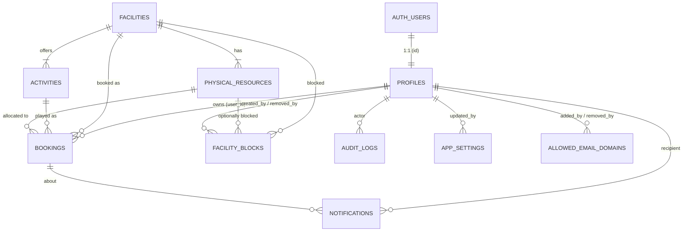

# DCU Active — Technical Requirement Document (TRD)

| Item | Value |
|---|---|
| Document | Technical Requirement Document |
| Product | DCU Active |
| Phase | Phase 4 — Integration, testing and hardening (as-built baseline) |
| Version | 1.0 (as built; staging release of 2026-10-14) |
| Date | 2026-10-14 |
| Status | BASELINE. Describes the system as built and deployed to staging. Open technical items are listed in Section 0.7. |

**Change log**

| Version | Date | Change |
|---|---|---|
| 0.1 | 2026-10-13 | First draft. |
| 0.2 | 2026-10-13 | PO decisions applied. (1) Email domain allow-list: new table `allowed_email_domains`, Auth hook, TR-AUTH-11/12, admin RPCs. (2) Admin settings screen in V1: `/admin/settings`, `admin_update_setting` with UI, new setting `user_cancel_cutoff_minutes`. (3) User cancellation cutoff 30 min before start. (4) Football Field 30/60/90 min (reference data). (5) Daily-limit backstop changed from a partial unique index to a transactional check, because the limit is now configurable. (6) TEST-36…54 mandatory. |
| 1.0 | 2026-10-14 | **As-built baseline** after Phases 1–4. Adds Section 0: pinned stack, environments and hosting as deployed, database objects, deviations DV-01…14 and UAT fixes, test status, and open technical items. TR-DEP-05 updated: staging is hosted on Cloudflare static assets. All PROPOSED items were accepted at the Phase 0 approval and implemented unless Section 0.5 says otherwise. |
| Related | `BRD.md` (business requirement IDs: BO-, FR-, BR-, NFR-), `REQUIREMENTS-TRACEABILITY-MATRIX.md`, `OPEN-DECISIONS.md` |

**Status labels:** APPROVED (from the baseline instruction), PROPOSED (team recommendation, default unless rejected), OPEN DECISION (`OD-xx`).

**Format of technical requirements:** each `TR-` item gives a description, the related business requirement, the proposed implementation approach, and the verification method (Test / DB test / Inspection / Analysis / Demo).

This document specifies **what** must be built and **how it will be verified**. Detailed design artefacts (final ERD, full DDL, the complete OpenAPI/RPC contract, wireframes) are Phase 1 deliverables. The data model and RPC list here are the **proposed baseline** for that design.

---

## 0. Version 1.0 — As-Built Technical Summary

This section describes the system **as built** on 2026-10-14. The requirement text and IDs in Sections 1–22 are kept from v0.2 for traceability. Where Section 0 and a later section differ, Section 0 describes the delivered system.

### 0.1 Pinned technology stack (from `package.json`; exact versions, no ranges)

| Layer | As built |
|---|---|
| Runtime / tooling | Node.js 24 LTS, npm 11, Docker Desktop (local Supabase), Git + GitHub (`riswara76/dcu-active`) |
| UI | React 19.3.0, React Router 8.4.0 (data router, SPA), TanStack Query 5.104.2, Tailwind CSS 4.3.3, `radix-ui` 1.8.1, `lucide-react` 1.56.0 |
| Language | TypeScript 6.0.3 (strict). TS 7 is not used, because `typescript-eslint` 8.71.2 supports TS below 6.1. |
| Build / PWA | Vite 8.3.4, `@vitejs/plugin-react` 6.1.2, `vite-plugin-pwa` 2.0.0, Workbox 7.4.1 |
| Backend client | `@supabase/supabase-js` 2.117.3; Supabase CLI 2.120.0 |
| Testing | Vitest 5.0.4 + jsdom 30.1.2 + Testing Library; Playwright 1.64.0; `@axe-core/playwright` 4.13.0; pgTAP (Supabase CLI); `pg` 8.23.1 |
| Lint | ESLint 9.39.5 (not 10, DV-10), `typescript-eslint` 8.71.2, `eslint-plugin-react`, `-react-hooks`, `-jsx-a11y` |
| Hosting CLI | Wrangler 4.150.0 (pinned) |
| Forms | Hand-written validation (not `react-hook-form`/`zod`, DV-09). The server remains the authority. |
| Date/time | `Intl.DateTimeFormat` with `Asia/Jakarta`; all business time calculations happen in the database |

### 0.2 Environments as deployed

| Environment | Database / Auth | Frontend hosting | Notes |
|---|---|---|---|
| Local | Supabase CLI stack in Docker, seeded with local test accounts (`supabase/seed.sql`) | `npm run dev` (5173) / `npm run preview` (4173) with the same security headers | Mailpit catches emails locally |
| CI | GitHub Actions `.github/workflows/ci.yml`: frontend job (lint, typecheck, unit, build, bundle secret scan) and database job (Supabase start, db lint, pgTAP, integration, E2E) | — | — |
| Staging | Supabase project `fuklxwviqczplonpreuh`, region Southeast Asia (Singapore), Free plan. 13 migrations applied; Auth settings pushed from `config.toml` `[remotes.staging]`. No seed data. | **Cloudflare static assets (Workers)** at https://dcu-active-staging.dcu-active.workers.dev, deployed with `npm run deploy:staging` (`wrangler.jsonc`: assets only, SPA fallback through `not_found_handling`, `workers_dev` on, preview URLs off) | Built-in email only delivers to project members; custom templates need custom SMTP (OD-03) |
| Production | Not yet created (paid plan, OD-09) | OD-01 / OD-02 | Phase 5 |

The build writes `dist/_headers` with the CSP, HSTS, other security headers, and cache rules (`/assets/*` immutable; `/sw.js` no-cache). Wrangler 4.150 serves Pages-style static sites through Workers static assets; no server code is deployed.

### 0.3 Database as built

- **13 migrations** (`supabase/migrations/20261014000001…13`): extensions and schemas; reference tables; profiles; settings and domains; bookings and blocks; notifications, audit and operations; private helpers; RLS and grants; user API; admin API; Realtime; Auth hook; cron jobs.
- **Schemas:** `api` (the only schema exposed through the Data API; functions only), `app` (tables, RLS on), `private` (helpers, hooks, jobs; not exposed).
- **API surface:** 33 functions in `api`, of which 19 are admin functions. Read functions for own data and admin lists run as SECURITY INVOKER under RLS. Write functions run as SECURITY DEFINER with `search_path = ''`. Every migration ends with explicit `revoke execute … from public, anon`, checked by pgTAP.
- **Integrity:** GiST exclusion constraint on `(resource_id, time_range)` for occupying statuses; lock order profile → resources → bookings; idempotency keys; transactional check for the configurable daily limit.
- **Auth hook:** `private.hook_before_user_created` enforces the email-domain allow-list (exact match, no subdomains).
- **Realtime:** private broadcast via `realtime.send`; the payload is only `{facility_code, date_wib}` (plus Realtime's own message id).
- **Scheduled jobs (`pg_cron`):** `booking-status` every minute (no-show release and completion; an in-transaction sweep also runs in booking functions), `purge-notifications` daily at 03:00 WIB (90-day retention), `integrity-check` daily at 03:15 WIB.
- **Test clock:** `private.now()` honours `app.test_now` only when the **session** sets `app.allow_time_override = on` (DV-03). API clients cannot do this.
- **Errors:** business errors are raised as SQLSTATE `P0001` with the stable error code as the message (Section 11.4).
- **First administrator:** promoted with `scripts/provision-admin.sql`, which writes an audit row (`ROLE_GRANT`, actor SYSTEM).

### 0.4 Frontend as built

- SPA with lazy-loaded admin routes. The PWA uses a prompt-to-update service worker that caches static assets only; API, Auth and Realtime traffic is never cached.
- Offline banner. React Query uses `networkMode: 'online'`, so nothing is queued while offline.
- Availability refresh: Realtime signal, with 30-second polling as fallback when Realtime is unavailable.
- Booking screen (after UAT): the duration choice is in the sticky action bar (UAT-01), and the slot grid highlights every slot covered by the chosen duration (UAT-02, BRD FR-AVL-06).
- Security: strict `script-src 'self'`; style `'unsafe-inline'` only (DV-11); `safeNext()` open-redirect guard; global handling of `ACCOUNT_DISABLED` / `NOT_AUTHENTICATED`; bundle secret scan in CI and before every staging deploy.

### 0.5 Deviations from v0.2 (approved in the phase reports)

| ID | v0.2 requirement | As built | Reason |
|---|---|---|---|
| DV-01 | `RATE_LIMITED` on `create_booking` (TR-SEC-13) | Not implemented in the database | A counter inside the booking transaction rolls back with failed requests. Effective limiting belongs before the database (gateway/network). Fair-use limits and Supabase platform limits apply. |
| DV-02 | `citext` for emails/domains | `text`, stored lower-case, with CHECK constraints | Avoids extension operator lookup with an empty `search_path` |
| DV-03 | Test clock enabled by a database setting | Enabled only per session | API clients cannot set it |
| DV-04 | `ALTER DEFAULT PRIVILEGES` | Explicit `REVOKE` per migration, enforced by a test | PostgreSQL cannot remove the PUBLIC default per schema |
| DV-05 | One audit row per admin action | One row per affected entity | Per-booking history |
| DV-06 | `audit_logs.request_id` | Omitted | Can be added without breaking changes |
| DV-07 | Realtime payload `{facility_code, date_wib}` | Same, plus Realtime's own message id | Added by Supabase |
| DV-08 | Edge Function to revoke sessions on deactivation (SHOULD) | Deferred | The database blocks deactivated users on their next action (TEST-25) |
| DV-09 | `react-hook-form` + `zod` | Hand-written validation | Smaller bundle (246 → 211 KB gzip) |
| DV-10 | ESLint 10 | ESLint 9.39.5 | Plugin support |
| DV-11 | `style-src 'self'` | `style-src 'self' 'unsafe-inline'` | Radix scroll lock injects a `<style>` element. Scripts remain strict. |
| DV-12 | — | Block form table choices fixed (1–2) | Inventory changes by migration |
| DV-13 | Support contact (OD-10) | `VITE_SUPPORT_CONTACT` placeholder | Pending OD-10 |
| DV-14 | Approved privacy notice | Draft text | Pending OD-17 |
| Hosting | TR-DEP-05: Cloudflare Pages, Vercel or Netlify | Staging on Cloudflare **Workers static assets** (the current Wrangler delivery path for Pages-style sites) | Equivalent capabilities: HTTPS, custom headers, SPA fallback |
| Staging Auth emails | Custom templates (TR-DEP-04) | Default templates on staging | Not available on the Free plan with the built-in sender; requires custom SMTP (OD-03) |

### 0.6 Test status (2026-10-14)

| Suite | Result |
|---|---|
| pgTAP database tests | 197 / 197 |
| API integration + concurrency | 17 / 17 (concurrency: 8 / 8 scenarios, 0 overlapping bookings) |
| Unit / component (Vitest) | 39 / 39 |
| End-to-end (Playwright: Android Chrome full; iPhone WebKit and desktop Chrome smoke), including axe accessibility checks | 41 / 41 |
| OWASP ZAP baseline | 0 FAIL, 62 PASS, 5 low/informational |
| `npm audit` | 0 vulnerabilities |
| Lighthouse mobile (login page) | Performance 91, Accessibility 100, Best practices 100 |
| Staging smoke tests | 9 / 9 (domain hook, weak password, tables not exposed, anon limits, health/cron) |
| Supabase Advisor (staging) | 0 ERROR; 23 WARN for intended SECURITY DEFINER functions |
| UAT findings | UAT-01 and UAT-02 fixed and deployed on 2026-10-14 |

### 0.7 Open technical items

| Item | Needed for |
|---|---|
| OD-03 custom SMTP for `DCU@danamon.co.id` (SPF/DKIM/DMARC), then push the branded templates | Real email delivery; self-registration on staging and production |
| OD-09 paid Supabase plan, daily backups, restore drill | Production |
| OD-01 / OD-02 production hosting and domain; update Auth Site URL and redirect URLs | Production |
| OD-08 monitoring (frontend errors, uptime, job-health alert) | Production |
| Real-device tests (TEST-28/29/31) and performance over a mobile network against staging | Phase 4 completion |
| DV-01 network-level rate limiting; DV-08 session revocation | Revisit if abuse is observed |
| Independent security review / penetration test | Go-live gate |

---

## 1. Technical Overview

DCU Active is a single-page web application (React + TypeScript, built with Vite) served as static files over HTTPS. All data, authentication, and business logic live in **Supabase**:

- PostgreSQL holds the data.
- Supabase Auth handles identity.
- Supabase Realtime pushes availability-change signals.
- `pg_cron` runs scheduled status processing.

Every state-changing business operation (booking, cancelling, check-in, admin actions) is executed by a **PostgreSQL function (RPC)** in a single database transaction. Each RPC performs authentication, authorization, validation, locking, and the write together. The browser holds only the public (publishable) Supabase key and the user's session token. It never holds privileged credentials, and it is never trusted to enforce rules.

```
┌─────────────────────────── Browser (Android/iOS/Desktop) ───────────────────────────┐
│ React SPA + React Router + TanStack Query  │  Service worker (static assets only)     │
│ Supabase JS client (publishable key + user JWT)                                      │
└──────────────┬───────────────────────┬──────────────────────────┬────────────────────┘
               │ HTTPS (Auth API)      │ HTTPS (PostgREST /rpc)   │ WSS (Realtime)
┌──────────────▼───────┐  ┌────────────▼──────────────────────┐  ┌▼───────────────────────┐
│ Supabase Auth        │  │ PostgreSQL                         │  │ Supabase Realtime      │
│ - email+password     │  │ - tables with RLS (read paths)     │  │ - private broadcast    │
│ - email OTP / link   │  │ - SECURITY DEFINER RPCs (writes)   │  │   "availability        │
│ - password policy    │  │ - exclusion/unique constraints     │  │    changed" signals    │
│ - SMTP provider      │  │ - pg_cron status processor         │  │   (no personal data)   │
└──────────────────────┘  │ - audit_logs (append-only)         │  └────────────────────────┘
                          └────────────────────────────────────┘
        (Optional) Supabase Edge Function: admin session revocation (service key server-side only)
```

---

## 2. Technology Stack

### 2.1 Selected stack (APPROVED baseline; versions PROPOSED)

The versions below are the **latest published versions on the npm registry as checked on 2026-10-13** (`npm view <pkg> version`). The local environment also has Node v24.19.0, npm 11.17.0, Docker 29.8.2, and Git 2.55.0.

Final pinned versions are confirmed by a compatibility spike at the start of Phase 2 and recorded in `package.json` and lockfile. Exact versions are pinned (no `^` ranges for core runtime dependencies).

| Layer | Package | Latest checked | Proposed selection | Compatibility notes (checked from registry peer/engine metadata) |
|---|---|---|---|---|
| Runtime | Node.js | v24.19.0 installed | Node 24 LTS | Vitest 5 requires Node ^22.12 / ^24 / ≥26. React Router 8 requires Node ≥22.22. Node 24 satisfies both. |
| UI | `react`, `react-dom` | 19.3.0 | 19.3.x | React Router 8 peer: react ≥19.2.7. TanStack Query 5 peer: react ^18 or ^19. |
| Language | `typescript` | 7.0.2 | **6.0.3** (PROPOSED) | `typescript-eslint` 8.71.2 declares peer `typescript >=4.8.4 <6.1.0`, so TS 7 is not yet supported by the lint toolchain. Re-evaluate TS 7 when typescript-eslint supports it. |
| Build | `vite` | 8.3.4 | 8.3.x | `@vitejs/plugin-react` 6.1.2 peer: vite ^8. `vite-plugin-pwa` 2.0.0 peer: vite ^3–^8. |
| Build | `@vitejs/plugin-react` | 6.1.2 | 6.1.x | Node ^20.19 or ≥22.12. |
| Routing | `react-router` | 8.4.0 | 8.4.x (library / "data router" mode, SPA) | New major version. The team must follow v8 docs, not older v6/v7 examples. |
| Server state | `@tanstack/react-query` | 5.104.2 | 5.104.x | — |
| Backend client | `@supabase/supabase-js` | 2.117.3 | 2.117.x | — |
| Backend CLI | `supabase` (CLI) | 2.120.0 | 2.120.x (dev dependency) | Local stack needs Docker (installed). |
| Validation | `zod` | 4.6.7 | 4.x | Shared form-schema validation (UX only). |
| PWA | `vite-plugin-pwa` | 2.0.0 | 2.0.x | Peer `workbox-build`/`workbox-window` ^7.4.1. Node ≥20.19. |
| PWA | `workbox-window`, `workbox-build` | 7.4.1 | 7.4.x | — |
| Unit test | `vitest` | 5.0.4 | 5.0.x + `jsdom` 30.x | — |
| E2E | `@playwright/test` | 1.64.0 | 1.64.x | Chromium + WebKit + mobile device emulation. |
| A11y | `@axe-core/playwright` | 4.13.0 | 4.13.x | — |
| Lint | `eslint` / `typescript-eslint` | 10.12.0 / 8.71.2 | as listed | See TS note above. |
| DB tests | pgTAP (via `supabase test db`) | bundled with Supabase CLI | — | — |
| UI kit | **PROPOSED:** Tailwind CSS + accessible headless primitives (e.g. Radix-based components) | — | Confirm in Phase 1 | Choice is open to the Phase 1 UX design. Must meet WCAG 2.2 AA. |
| Date/time | **PROPOSED:** `Intl.DateTimeFormat` with `timeZone: 'Asia/Jakarta'` (no heavy date library), or `date-fns` + `@date-fns/tz` if needed | — | Confirm in Phase 1 | All business time math happens in the database. The frontend only formats. |

> **Note on the installed "Nathan" skill:** the workspace contains a "vibe-coding-stack-setup" skill (Nathan) that prescribes Next.js, Clerk, Firebase, and Vercel. That stack **conflicts** with this approved baseline (Vite/React SPA, Supabase Auth, PostgreSQL). For this project the master instruction takes precedence, and the Nathan skill must not be used for scaffolding.

### 2.2 Technical requirements — stack

| ID | Description | Related | Approach | Verification |
|---|---|---|---|---|
| TR-STK-01 | Use React + TypeScript (strict mode) + Vite, React Router, TanStack Query, and Supabase JS. | BO-10 | `tsconfig` `strict: true`. ESLint with type-aware rules. | Inspection; CI build |
| TR-STK-02 | Pin exact dependency versions and commit the lockfile. Use only maintained versions. Record versions in `docs/architecture/VERSIONS.md` (Phase 1/2). | BO-10 | `npm ci` in CI; Renovate/Dependabot (PROPOSED). | Inspection |
| TR-STK-03 | `npm audit` (production dependencies) reports no High/Critical vulnerabilities at each release. | NFR-02 | CI step. | CI report |

---

## 3. Architecture Principles

| ID | Principle | Related |
|---|---|---|
| AP-01 | **Server is the authority.** Every rule (BR-01…BR-30) is enforced in PostgreSQL. The frontend repeats checks only to give fast feedback. | BR-15, BR-16 |
| AP-02 | **Writes go through RPCs only.** The `authenticated` and `anon` roles get **no** direct INSERT/UPDATE/DELETE privileges on business tables. Mutations happen only via SECURITY DEFINER functions with a fixed `search_path`. | SEC-07, SEC-16 |
| AP-03 | **Defence in depth for correctness.** Transactional checks (with row locks) are backed by database constraints where the rule is fixed: a GiST exclusion constraint for overlaps. Configurable limits (active bookings, daily limit) are enforced inside the transaction under a per-user row lock. | BR-11, BR-20 |
| AP-04 | **Least privilege & privacy by design.** Availability outputs contain no owner data. RLS restricts reads. Realtime carries only "something changed" signals. | SEC-03, SEC-05 |
| AP-05 | **Time is server time, in UTC, interpreted in Asia/Jakarta.** Use `timestamptz` storage and `now()` from the database. Frontend clocks are never authoritative. | BR-19 |
| AP-06 | **Nothing is hard-deleted.** Cancellation, deactivation, and block removal are state changes with audit records. | FR-CXL-02, FR-ADM-09 |
| AP-07 | **Online-only transactions.** The service worker caches static assets only. API traffic is never cached or queued. | Sec. 28 |
| AP-08 | **Stable business error contract.** RPCs raise coded errors, and the UI maps codes to plain-English messages. | Sec. 33 |
| AP-09 | **Configuration over code** for tunable policy values (check-in window, horizon, limits), stored in `app_settings`. | FR-CHK-03 |

---

## 4. Functional Architecture

| Layer | Responsibility | Components |
|---|---|---|
| 1. Presentation | Screens, routing, forms, client-side validation, WIB formatting, offline banner, PWA update prompt | React components, React Router routes (public / user / admin route groups with lazy loading), design system |
| 2. Authentication | Sign-up, verification (code + scanner-safe link), sign-in, sign-out, password reset, session refresh | Supabase Auth (GoTrue), custom SMTP, Supabase JS auth client (PKCE flow) |
| 3. Application service | Typed API client wrapping RPC calls, error-code mapping, React Query caching/invalidation, Realtime subscription manager | `src/services/*`, `src/api/*` (Phase 1 design) |
| 4. Database transaction | Business rules, locking, constraint enforcement, status processing, audit, notifications | PostgreSQL functions in an `api` set (exposed) and `private` schema (not exposed), triggers, `pg_cron` jobs |
| 5. Realtime notification | Availability-changed broadcast. Own-notification delivery. | DB triggers → `realtime.send()` on private channels. Client subscribes and invalidates queries. |

Frontend route groups (PROPOSED; screens map to the instruction's Section 31):

| Route | Screen(s) | Access |
|---|---|---|
| `/login`, `/register`, `/verify`, `/auth/confirm`, `/forgot-password`, `/reset-password` | 1–5 | Public (redirect to `/` if signed in) |
| `/account-disabled` | 6 | Signed-in but inactive |
| `/` | 7 Home (upcoming booking, check-in banner, quick facility tiles) | USER |
| `/facilities` | 8 Facility listing | USER |
| `/facilities/:code` | 9 Facility details + 10 date strip + 11 slot grid + duration (consolidated) | USER |
| `/facilities/:code/review` (bottom sheet/modal on mobile) | 12 Booking review | USER |
| `/bookings/:id/confirmed` | 13 Confirmation | USER |
| `/bookings` (tabs: Upcoming / History) | 14 My Bookings + 16 History (consolidated) | USER |
| `/bookings/:id` | 15 Booking details | USER (owner) |
| `/profile` (+ notifications list) | 17 Profile | USER |
| `/admin` | 18 Dashboard | ADMIN |
| `/admin/bookings` | 19 Booking management | ADMIN |
| `/admin/blocks` | 20 Facility blocking | ADMIN |
| `/admin/users`, `/admin/users/:id` | 21 User management | ADMIN |
| `/admin/audit` | Audit viewer (PROPOSED FR-ADM-10) | ADMIN |
| `/admin/settings` (tabs: Booking settings / Email domains) | Settings screen (FR-ADM-13) + allowed email domains (FR-ADM-12) | ADMIN |
| global components | 22 Offline banner, 23 Error boundary, 24 Empty states, 25 PWA update toast | All |
| `*` | 26 Not found | All |

**Proposed screen consolidation (needs UX approval in Phase 1):**

- **Facility details, Availability calendar, and Time-slot selection become one screen.** The horizon is only 8 days, so a horizontal date strip replaces a full calendar. The slot grid and duration chips sit directly below it. This keeps the journey within 3–5 taps.
- **Booking review is a bottom sheet** on mobile (a modal on desktop). The user keeps their context and can change a slot in one tap.
- **My Bookings and Booking history are tabs** on one screen.
- **Email verification is one screen** with a code input and a "resend" action. The link lands on `/auth/confirm` with a confirm button.

---

## 5. Database Requirements

| ID | Description | Related | Approach | Verification |
|---|---|---|---|---|
| TR-DB-01 | Normalized PostgreSQL schema that separates FACILITY, ACTIVITY, and PHYSICAL RESOURCE. | Sec. 4 of instruction | Tables `facilities`, `activities`, `physical_resources` with FKs. | Inspection; pgTAP schema tests |
| TR-DB-02 | All schema changes are delivered as versioned SQL migrations in `supabase/migrations/`, applied by the Supabase CLI. No manual production changes. | BO-10 | `supabase migration new`, `supabase db push` from CI. | Inspection; CI |
| TR-DB-03 | Reference data (facilities, activities, resources, settings) is seeded by migration (idempotent). Test users come only from `seed.sql` for local/staging. | Sec. 4 | Separate migration for reference data. | pgTAP |
| TR-DB-04 | Time-zone-aware storage: every instant is `timestamptz` (UTC). Business dates are `date` in WIB. | BR-19 | See Section 6. | pgTAP |
| TR-DB-05 | Enums for statuses and categories as PostgreSQL enum types (or check-constrained text). | FR-STS-01 | `booking_status`, `block_category`, `app_role`, `cancel_source`. | pgTAP |
| TR-DB-06 | Required extensions: `btree_gist` (exclusion constraint), `pg_cron` (scheduler). `pgcrypto`/`gen_random_uuid()` is built in. | BR-11 | Enabled by migration. | pgTAP |
| TR-DB-07 | RLS is enabled on **every** table in exposed schemas. A test fails if any exposed table lacks RLS. | SEC-02 | pgTAP test over `pg_tables`/`pg_class.relrowsecurity`. | pgTAP |
| TR-DB-08 | No hard deletes of bookings, blocks, profiles, or audit logs from application roles. | AP-06 | Revoke DELETE. Trigger blocks DELETE/UPDATE on `audit_logs`. | pgTAP |

---

## 6. Data Model (PROPOSED baseline for Phase 1 ERD)

### 6.1 Entity relationship overview



### 6.2 Tables

Notation: PK = primary key, FK = foreign key, NN = not null. "Access" lists who can read or write via the API. All writes are performed only by RPCs (AP-02).

#### `profiles` — one row per user (extends `auth.users`)

| Column | Type | Constraints |
|---|---|---|
| id | uuid | PK, FK → `auth.users(id)` ON DELETE RESTRICT |
| full_name | text | NN, length 2–100, trimmed |
| email | citext | NN, unique (copied from auth for admin search; kept in sync by trigger) |
| role | `app_role` (`USER`,`ADMIN`) | NN default `USER` |
| is_active | boolean | NN default true |
| deactivated_at / deactivated_by / deactivation_reason | timestamptz / uuid FK profiles / text | nullable; reason required when inactive (CHECK) |
| created_at / updated_at | timestamptz | NN default now() |

- **Indexes:** unique(email); `pg_trgm` GIN on full_name and email for admin search (PROPOSED).
- **Creation:** a trigger on `auth.users` insert creates the profile with role USER (from sign-up metadata `full_name`, sanitised). The client cannot choose its role.
- **Access:** user SELECT own row. Admin SELECT all. No direct writes. `update_my_profile` lets a user change only `full_name`.

#### `facilities`

| Column | Type | Constraints |
|---|---|---|
| id | smallint identity | PK |
| code | text | NN unique (`TENNIS`, `COURT`, `TABLE_TENNIS`, `FOOTBALL`, `AIR_HOCKEY`, `FOOSBALL`) |
| name | text | NN |
| description | text | |
| allowed_durations | smallint[] | NN; CHECK each ∈ {30,60,90}, non-empty, sorted |
| allocation_mode | text | NN CHECK in (`SINGLE`,`AUTO_POOL`) |
| display_order | smallint | NN |
| is_active | boolean | NN default true |

**Access:** SELECT for `authenticated` (active only for USER).

#### `activities`

| Column | Type | Constraints |
|---|---|---|
| id | smallint identity | PK |
| facility_id | smallint | NN FK → facilities |
| code | text | NN unique (`TENNIS`, `BASKETBALL`, `FUTSAL`, …) |
| name | text | NN |
| is_active | boolean | NN default true |
| — | — | UNIQUE (id, facility_id), the target for a composite FK from bookings |

**Access:** SELECT `authenticated`.

#### `physical_resources`

| Column | Type | Constraints |
|---|---|---|
| id | smallint identity | PK |
| facility_id | smallint | NN FK → facilities |
| code | text | NN unique (`TENNIS_COURT_1`, `MULTI_COURT_1`, `AIR_HOCKEY_1`, `AIR_HOCKEY_2`, …) |
| name | text | NN |
| allocation_order | smallint | NN; UNIQUE (facility_id, allocation_order) |
| is_active | boolean | NN default true |
| — | — | UNIQUE (id, facility_id) |

**Access:** SELECT `authenticated` — PROPOSED: id/name visible to all (non-personal). The booking's allocated resource is visible only to its owner and to admins.

#### `bookings`

| Column | Type | Constraints |
|---|---|---|
| id | uuid | PK default gen_random_uuid() |
| booking_ref | text | NN unique, human-readable (e.g. `DCU-261014-7K3Q`) |
| user_id | uuid | NN FK → profiles |
| facility_id | smallint | NN |
| activity_id | smallint | NN; FK (activity_id, facility_id) → activities(id, facility_id) |
| resource_id | smallint | NN; FK (resource_id, facility_id) → physical_resources(id, facility_id) |
| booking_date | date | NN, WIB date of start (set by RPC; CHECK via trigger) |
| start_at, end_at | timestamptz | NN; CHECK end_at = start_at + duration |
| time_range | tstzrange | generated `tstzrange(start_at, end_at, '[)')` stored |
| duration_minutes | smallint | NN CHECK in (30,60,90) |
| status | `booking_status` | NN default `CONFIRMED` |
| checked_in_at, completed_at, no_show_at | timestamptz | nullable; consistency CHECKs per status |
| cancelled_at, cancelled_by, cancel_source, cancellation_reason | timestamptz, uuid FK profiles, `cancel_source` (`USER`,`ADMIN`,`BLOCK`,`DEACTIVATION`), text | required when status ∈ {CANCELLED, ADMIN_CANCELLED}; reason required for ADMIN_CANCELLED |
| block_id | uuid | FK → facility_blocks (when cancelled by a block) |
| idempotency_key | uuid | NN; UNIQUE (user_id, idempotency_key) |
| created_at, updated_at | timestamptz | NN |

Constraints and indexes:

- **Exclusion constraint (no overlap):**
  `EXCLUDE USING gist (resource_id WITH =, time_range WITH &&) WHERE (status IN ('CONFIRMED','CHECKED_IN','COMPLETED'))`
- **Daily limit (BR-06/BR-22):** counted inside `create_booking` under the profile row lock, over statuses CONFIRMED, CHECKED_IN, COMPLETED, NO_SHOW. A partial unique index is **not** used, because the limit is configurable (FR-ADM-13) and may be set above 1.
- Index (facility_id, booking_date).
- Index (user_id, facility_id, booking_date) for the daily-limit check.
- Index (user_id, status, end_at).
- Index (status, start_at) for the status processor.

**Access:** USER SELECT where `user_id = auth.uid()` (via `my_bookings` RPC/view). ADMIN SELECT all. No direct writes.

#### `facility_blocks`

| Column | Type | Constraints |
|---|---|---|
| id | uuid | PK |
| facility_id | smallint | NN FK |
| resource_id | smallint | nullable; FK (resource_id, facility_id). NULL = whole facility |
| start_at, end_at | timestamptz | NN; end > start; 30-min aligned; within operating hours per day (BR-29) |
| time_range | tstzrange | generated, GiST index |
| category | `block_category` (`MAINTENANCE`,`EVENT`,`OPERATIONAL`,`OTHER`) | NN |
| reason | text | NN, 5–500 chars |
| created_by, created_at | uuid FK profiles, timestamptz | NN |
| removed_at, removed_by, removal_reason | timestamptz, uuid, text | nullable (soft removal) |

**Access:** ADMIN SELECT all. USER sees only the effect through availability RPCs: "Unavailable – Maintenance", "Unavailable – Event", "Unavailable – Operational", or "Unavailable" (OTHER). Users never see the reason text or the creator (APPROVED, PO, OD-15).

#### `app_settings`

| Column | Type | Constraints |
|---|---|---|
| key | text | PK |
| value | jsonb | NN; validated per key by CHECK/trigger |
| description | text | |
| updated_at, updated_by | timestamptz, uuid | |

Seeded keys (defaults):

| Key | Default |
|---|---|
| `timezone` | `"Asia/Jakarta"` (read-only in V1) |
| `slot_minutes` | 30 (read-only in V1) |
| `operating_open` | `"06:00"` |
| `operating_close` | `"21:00"` |
| `booking_horizon_days` | 7 |
| `max_active_bookings` | 2 |
| `max_bookings_per_facility_per_day` | 1 |
| `checkin_open_before_minutes` | 15 |
| `checkin_close_after_minutes` | 15 |
| `user_cancel_cutoff_minutes` | 30 |
| `notification_retention_days` | 90 |

**Editable from the admin settings screen (FR-ADM-13), with server-side range validation:**

| Key | Range |
|---|---|
| `checkin_open_before_minutes` | 0–60 |
| `checkin_close_after_minutes` | 5–60 |
| `user_cancel_cutoff_minutes` | 0–240 |
| `booking_horizon_days` | 0–30 |
| `max_active_bookings` | 1–10 |
| `max_bookings_per_facility_per_day` | 1–5 |

`timezone`, `slot_minutes`, `operating_open`, `operating_close`, and `notification_retention_days` are read-only in V1.

**Access:** non-sensitive keys readable via `get_app_config()`. Changes only via `admin_update_setting` (settings screen). Every change is audited with old and new values. Changes apply to subsequent operations; existing bookings are never cancelled by a settings change.

#### `allowed_email_domains` (new in v0.2)

| Column | Type | Constraints |
|---|---|---|
| id | uuid | PK |
| domain | citext | NN; lowercase; CHECK valid hostname pattern (letters, digits, hyphens, dots; at least one dot; no leading "@"); UNIQUE among active rows (partial unique index `WHERE removed_at IS NULL`) |
| added_by, added_at | uuid FK profiles (NULL for seed), timestamptz | NN added_at |
| removed_by, removed_at, removal_reason | uuid, timestamptz, text | nullable (soft removal) |

- **Seed:** `danamon.co.id`, `adira.co.id`, `homecredit.co.id`.
- **Matching rule:** lower(split_part(email, '@', 2)) must **equal** an active domain. Subdomains do not match (OD-32).
- **Safeguard:** at least one active domain must remain (`LAST_DOMAIN_PROTECTED`).
- **Rename:** implemented as an audited update of `domain` on the active row (old and new value recorded).
- **Removal:** does not affect existing profiles (OD-30).
- **Access:** ADMIN SELECT. Anonymous visitors get only the list of active domain names via `get_registration_domains()`, for display on the registration screen. Writes only via admin RPCs.

#### `audit_logs` (append-only)

| Column | Type | Constraints |
|---|---|---|
| id | bigint identity | PK |
| occurred_at | timestamptz | NN default now() |
| actor_id | uuid | nullable (NULL = system) FK profiles |
| actor_role | text | NN (`USER`,`ADMIN`,`SYSTEM`) |
| action | text | NN (e.g. `BOOKING_ADMIN_CANCEL`, `BLOCK_CREATE`, `BLOCK_REMOVE`, `USER_DEACTIVATE`, `USER_ACTIVATE`, `ROLE_GRANT`, `ROLE_REVOKE`, `SETTING_UPDATE`; PROPOSED also `BOOKING_CREATE`, `BOOKING_CANCEL`, `BOOKING_CHECKIN`, `BOOKING_NO_SHOW`) |
| entity_type, entity_id | text, text | NN |
| before, after | jsonb | nullable; personal data minimised |
| reason | text | |
| request_id | uuid | correlates with the RPC call |

- **Indexes:** (occurred_at desc), (entity_type, entity_id), (actor_id).
- **Access:** ADMIN SELECT. Nobody may UPDATE or DELETE (trigger raises an error). Inserts happen only from within RPCs.

#### `notifications`

| Column | Type | Constraints |
|---|---|---|
| id | uuid | PK |
| user_id | uuid | NN FK |
| type | text | NN (`BOOKING_CONFIRMED`, `BOOKING_CANCELLED`, `CHECKED_IN`, `ADMIN_CANCELLED`, `ACCOUNT_DEACTIVATED`, `NO_SHOW`) |
| title, body | text | NN |
| booking_id | uuid | nullable FK |
| created_at, read_at | timestamptz | |

**Access:** USER SELECT/mark-read own via RPC. Purged after the retention period by `pg_cron`.

#### Not added (and why)

- **`operating_hours` per facility/day:** not needed in V1 (A-02). It is a future enhancement (FE-04) and can be added without breaking changes.
- **`booking_participants`:** explicitly not required (BR-09).
- **`user_roles` table:** a single role per user in V1. Role sits on `profiles` and is protected by the "RPC-only writes" rule. It can be split out later if multiple roles are needed.

### 6.3 How the design supports the key rules

| Concern | Design mechanism |
|---|---|
| Shared Basketball/Futsal | Two `activities` rows belong to facility `COURT`, which has **one** `physical_resources` row. Overlap is prevented per `resource_id`, so either activity blocks the other. The daily limit is keyed by `facility_id`, so the court counts once per day (BR-18). |
| Multiple Air Hockey / Foosball tables | Facility `allocation_mode = AUTO_POOL` with 2 resources each. The RPC locks the pool and assigns the lowest `allocation_order` free table (BR-27). Availability returns `available_count / total_count`. |
| Booking durations | `facilities.allowed_durations` + CHECK on `bookings.duration_minutes` + `end_at = start_at + duration`. A single row = one continuous interval (BR-17). |
| Resource blocking | `facility_blocks` with nullable `resource_id`. Both availability and booking RPCs treat an active block (not removed, overlapping) as unavailable. Booking and block RPCs lock the same resource rows, so they serialize. |
| Cancellation history | Status change + `cancelled_*` columns + `cancel_source` + `block_id` + audit row. No deletes. |
| Check-in | `checked_in_at` set by `check_in` RPC within the window from `app_settings`. |
| No-show | `pg_cron` processor (every minute) plus an in-transaction "lazy sweep" in booking RPCs. Moving to NO_SHOW removes the row from the exclusion predicate, which frees the resource. |
| Fair-use limits | Profile row lock serializes one user's requests. Count checks for active bookings and the daily limit run inside the transaction against the current `app_settings` values. |
| Registration domains | `allowed_email_domains` checked by the Auth "Before User Created" hook (TR-AUTH-11). |
| Cancellation cutoff | `cancel_my_booking` compares server time with `start_at − user_cancel_cutoff_minutes`. |

---

## 7. Booking Transaction Requirements

### 7.1 Requirements

| ID | Description | Related | Approach | Verification |
|---|---|---|---|---|
| TR-BKG-01 | `create_booking` performs all 11 steps of instruction Section 23 in **one** transaction and either commits a CONFIRMED booking or makes no change. | BR-10, BR-15 | PL/pgSQL SECURITY DEFINER function. | pgTAP + integration |
| TR-BKG-02 | Inputs are business-level, not raw timestamps: `facility_code`, `activity_code`, `booking_date` (date), `start_time` ('HH:MM'), `duration_minutes`, `idempotency_key`. The server derives `start_at`/`end_at` in Asia/Jakarta. | BR-19, Sec. 26 | `make_timestamptz` / `(date + time) AT TIME ZONE 'Asia/Jakarta'`. | pgTAP (TEST-27 support) |
| TR-BKG-03 | Validation order and error codes as in 7.2. The first failing rule determines the error. | Sec. 33 | — | pgTAP per rule |
| TR-BKG-04 | Idempotency: the same (user, idempotency_key) returns the original booking instead of a new one. | FR-BKG-05 | Unique index + lookup first. | pgTAP |
| TR-BKG-05 | Pooled allocation picks the lowest `allocation_order` free resource. | BR-13, BR-27 | Ordered loop over locked resources. | pgTAP (TEST-09, 11) |
| TR-BKG-06 | Response includes booking id, reference, facility/activity names, resource name (owner only), WIB date/times, duration, status, and check-in window open/close (WIB). | FR-BKG-06 | JSON result. | Integration |
| TR-BKG-07 | Success inserts an in-app notification and (PROPOSED) an audit row. It emits an availability-changed signal after commit. | FR-NTF-01, Sec. 27 | Trigger → `realtime.send`. | Integration |
| TR-BKG-08 | `cancel_my_booking`, `check_in`, `admin_cancel_booking`, `admin_create_block`, and `admin_set_user_active` follow the same transactional pattern (lock target rows, validate, write, audit, notify). | Sec. 11–15 | — | pgTAP |
| TR-BKG-09 | Booking status transitions are enforced by a trigger. Illegal transitions (e.g. NO_SHOW → CHECKED_IN, CANCELLED → CONFIRMED) raise an error even for privileged code paths. | FR-STS-01 | `BEFORE UPDATE` trigger with a transition table. | pgTAP |

### 7.2 `create_booking` algorithm (PROPOSED)

```
BEGIN (READ COMMITTED)
 1  uid := auth.uid();  IF null → NOT_AUTHENTICATED
 2  SELECT * FROM profiles WHERE id = uid FOR UPDATE              -- serializes this user's requests
    IF NOT is_active → ACCOUNT_DISABLED
    IF auth.users.email_confirmed_at IS NULL → EMAIL_NOT_VERIFIED
    IF existing booking with (uid, idempotency_key) → RETURN it
 3  Load facility (active) + activity (active, belongs to facility) → FACILITY_NOT_FOUND / ACTIVITY_INVALID
 4  today := (now() AT TIME ZONE 'Asia/Jakarta')::date
    IF booking_date < today OR booking_date > today + horizon → BOOKING_WINDOW_EXCEEDED
 5  IF start_time minute ∉ {0,30} or seconds ≠ 0 → SLOT_MISALIGNED
    start_at := (booking_date + start_time) AT TIME ZONE 'Asia/Jakarta'; end_at := start_at + duration
    IF local start < 06:00 OR local end > 21:00 → OUTSIDE_OPERATING_HOURS
    IF start_at <= now() → SLOT_IN_PAST
 6  IF duration ∉ facility.allowed_durations → INVALID_DURATION
 7  Lazy sweep: mark this user's overdue CONFIRMED bookings as NO_SHOW and CHECKED_IN past end as COMPLETED
    IF count(active/future bookings of uid) >= max_active → BOOKING_LIMIT_REACHED              (BR-05/BR-21)
    IF exists counting booking (uid, facility, booking_date) → FACILITY_DAILY_LIMIT_REACHED     (BR-06/BR-22)
 8  SELECT id FROM physical_resources WHERE facility_id = f AND is_active
      ORDER BY allocation_order FOR UPDATE                          -- serializes bookers & blockers of this facility
    Lazy sweep: release overdue no-shows on these resources (status → NO_SHOW)
 9  FOR r IN locked resources:
       IF active block overlaps (facility-wide OR resource r) → continue
       IF occupying booking on r overlaps [start_at, end_at) → continue
       chosen := r; EXIT
    IF chosen IS NULL → SLOT_UNAVAILABLE
10  INSERT booking (status CONFIRMED, resource chosen, booking_ref, idempotency_key)
      ON exclusion_violation (23P01) → SLOT_UNAVAILABLE                 -- backstop
    INSERT notification; INSERT audit (PROPOSED)
11  RETURN confirmation JSON
COMMIT  → AFTER trigger emits realtime availability signal
```

---

## 8. Concurrency Requirements

| ID | Description | Related | Approach | Verification |
|---|---|---|---|---|
| TR-CON-01 | Two bookings with status in {CONFIRMED, CHECKED_IN, COMPLETED} can never overlap on the same resource, even if application code has a bug. | BR-11 | GiST exclusion constraint (needs `btree_gist`). | pgTAP: direct insert of an overlap fails |
| TR-CON-02 | Simultaneous requests for the same single resource and slot: exactly one succeeds, the others get `SLOT_UNAVAILABLE`. | BR-20 | Row lock on resources (step 8) + exclusion backstop. | Concurrency test: 20 parallel clients → 1 success (TEST-07, 26) |
| TR-CON-03 | Three simultaneous Air Hockey (or Foosball) requests for the same slot from 3 users: exactly 2 succeed on **different** tables, and 1 fails. | BR-13, Sec. 24 | Pool lock + ordered allocation. | Concurrency test (TEST-09–12) repeated ≥ 50 iterations |
| TR-CON-04 | One user firing simultaneous requests (multiple tabs/direct API) cannot exceed the configured active-booking limit (default 2) or daily facility limit (default 1). | BR-05, BR-06, Sec. 10 | Profile row `FOR UPDATE` serializes all booking requests of one user, so the count checks cannot race. | Concurrency test: 10 parallel requests from one user → ≤ 2 succeed (TEST-13, 14, 34) |
| TR-CON-05 | Booking vs admin block race: a booking cannot be committed inside a block that commits concurrently. | ADMIN-03 | Both RPCs lock the same `physical_resources` rows (consistent order). | Concurrency test |
| TR-CON-06 | Deadlock avoidance: fixed lock order **profile → physical_resources (by allocation_order) → bookings**. Admin RPCs that do not touch profiles start at resources. The status processor uses `FOR UPDATE SKIP LOCKED`. | — | Code review rule. | Analysis + stress test with no deadlock errors |
| TR-CON-07 | Isolation level READ COMMITTED with explicit locks. If any RPC relies on SERIALIZABLE, it must retry on `40001` (max 3 attempts). | — | Default; documented. | Inspection |
| TR-CON-08 | Booking RPCs set `lock_timeout` (PROPOSED 3 s) and `statement_timeout` (PROPOSED 10 s). A timeout returns `SYSTEM_BUSY` (retryable), not a raw error. | NFR-03 | `SET LOCAL`. | Fault-injection test |

---

## 9. Authentication and Authorization

| ID | Description | Related | Approach | Verification |
|---|---|---|---|---|
| TR-AUTH-01 | Supabase Auth email+password provider only. Other providers disabled. Sign-ups enabled. "Confirm email" **on**. | FR-AUTH-01/02 | Dashboard/`config.toml` settings, environment-specific. | Inspection; TEST-01 |
| TR-AUTH-02 | Password policy enforced server-side: minimum length 8 + required lowercase, uppercase, digits, symbols. PROPOSED: enable leaked-password protection where the plan supports it. | FR-AUTH-07 | Supabase Auth password requirements setting. | Integration test calls the Auth API directly with a weak password → rejected |
| TR-AUTH-03 | Verification email contains **both** a 6-digit code (`{{ .Token }}`) and a link to `https://<app>/auth/confirm?token_hash={{ .TokenHash }}&type=signup`. The confirm page calls `verifyOtp({ token_hash, type })` **only after the user clicks "Confirm my email"**, so a GET by an email scanner does not consume the token. | FR-AUTH-02 | Custom email templates. PKCE flow. | E2E: GET link without click → still unverified; click → verified |
| TR-AUTH-04 | Password reset: the email contains a code and a scanner-safe link (`type=recovery`). OTP expiry PROPOSED ≤ 60 min. After reset, PROPOSED: sign out other sessions (`signOut({ scope: 'others' })`). | FR-AUTH-05/06 | Supabase recovery OTP. | TEST-03 |
| TR-AUTH-05 | Auth rate limits configured: email sends per hour, OTP verifications, sign-in attempts (Supabase Auth rate-limit settings). CAPTCHA (e.g. Turnstile/hCaptcha via Supabase Auth) PROPOSED as SHOULD if abuse appears. | SEC-13 | Settings. | Inspection |
| TR-AUTH-06 | Sessions: access-token (JWT) expiry PROPOSED 3600 s (default). Refresh-token rotation and reuse detection on. PROPOSED inactivity timeout 7 days / time-box 30 days if the plan supports it. | FR-AUTH-08, SEC-17 | Auth settings. | Inspection |
| TR-AUTH-07 | **Authorization is checked in the database on every call** using `auth.uid()` + `profiles` (role, is_active), **not** JWT custom claims. This makes deactivation and role changes effective immediately, even with a still-valid JWT. | FR-AUTH-09/10, SEC-19 | Private helper functions `private.current_user_active()`, `private.is_admin()` (SECURITY DEFINER, STABLE). Used in every RPC and RLS policy. | TEST-24, TEST-25 |
| TR-AUTH-08 | On deactivation, PROPOSED (SHOULD): also revoke Auth sessions (ban the user in Auth) through an Edge Function that holds the secret key server-side. The DB check in TR-AUTH-07 is the guaranteed control. This is an extra layer. | SEC-19 | Edge Function `admin-revoke-sessions` callable only by admins (verifies the caller's JWT + `is_admin`). | Integration |
| TR-AUTH-09 | Redirect safety: Supabase Auth "Redirect URLs" allow-list contains only the environment's exact app origins. In-app `?next=` parameters accept only same-origin relative paths matching an allow-listed route pattern. | SEC-11 | Utility `safeNext()`. | Unit tests + TEST open-redirect case |
| TR-AUTH-10 | Initial administrator provisioning: a one-off, audited SQL script run by the operator (service context) that promotes an existing verified account to ADMIN. The account's email domain must be on the allowed list. No admin self-registration path exists. | ADMIN-04, ROLE-06 | `scripts/provision-admin.sql` (Phase 2). | Demo; TEST-24 |
| TR-AUTH-11 | **Email domain enforcement at sign-up, in the backend.** Supabase Auth **"Before User Created" hook** (Postgres function) rejects sign-ups whose email domain does not exactly match an active row in `allowed_email_domains`, returning error `EMAIL_DOMAIN_NOT_ALLOWED`. Fallback if the hook is not available on the chosen plan: a `BEFORE INSERT` trigger on `auth.users` that raises the same error. The fallback is confirmed in the Phase 2 compatibility spike. The registration form repeats the check for fast feedback only. | FR-AUTH-12 | Auth hook + `private.is_email_domain_allowed(email)`. | TEST-52: direct Auth API sign-up with `@gmail.com` and with a subdomain is rejected; allowed domains succeed (case-insensitive) |
| TR-AUTH-12 | Domain checks also apply to **admin role grants**: `admin_set_user_role` to ADMIN fails with `EMAIL_DOMAIN_NOT_ALLOWED` if the target's domain is not currently allowed. Existing users are **not** re-checked at login when a domain is removed (OD-30). | ROLE-06 | RPC validation. | TEST-53 |

---

## 10. RLS Requirements

| ID | Table | SELECT | INSERT/UPDATE/DELETE |
|---|---|---|---|
| TR-RLS-01 | profiles | Own row; admin all | None (RPC only) |
| TR-RLS-02 | facilities, activities, physical_resources | `authenticated` (users: active rows) | None |
| TR-RLS-03 | bookings | Own rows (`user_id = auth.uid()`); admin all | None (RPC only) |
| TR-RLS-04 | facility_blocks | Admin only | None |
| TR-RLS-05 | app_settings | Admin only (public subset via `get_app_config()`) | None |
| TR-RLS-09 | allowed_email_domains | Admin only (active domain names to anon via `get_registration_domains()`) | None (RPC only) |
| TR-RLS-06 | audit_logs | Admin only | None (no UPDATE/DELETE for any role; trigger guard) |
| TR-RLS-07 | notifications | Own rows | None (mark read via RPC) |
| TR-RLS-08 | `realtime.messages` | Authenticated + active users may receive on `availability:*` topics. Users may receive `user:<own uid>` topics only. | Clients cannot broadcast (insert denied) |

Further rules:

- `anon` has no SELECT on any business table.
- All RLS policies include `private.current_user_active()` so a deactivated user's existing JWT reads nothing beyond their own profile. This is what makes the Account disabled screen work.
- **Verification:** pgTAP tests that impersonate USER A, USER B, ADMIN, a deactivated user, and anon (`set local role` + `request.jwt.claims`) and assert row visibility (TEST-23, 24, 25).

---

## 11. API / RPC Requirements

All RPCs are exposed via PostgREST `POST /rest/v1/rpc/<name>`. Common behaviour:

- `SECURITY DEFINER`, `SET search_path = ''`.
- EXECUTE granted to `authenticated` only (not `anon`/`public`). The single exception is `get_registration_domains`, which `anon` may call to display the allowed domains on the registration screen.
- Every RPC first checks the user is authenticated and active, unless noted otherwise.
- Errors use the standard format (Section 11.3).
- Each RPC runs as **one transaction**.

The full contract (JSON schemas) is a Phase 1 deliverable.

### 11.1 User-facing operations

| Name | Purpose | Input | Output | AuthN / AuthZ | Key validation | Errors | Transaction behaviour |
|---|---|---|---|---|---|---|---|
| Supabase Auth: `signUp`, `verifyOtp`, `resend`, `signInWithPassword`, `signOut`, `resetPasswordForEmail`, `updateUser` | Account lifecycle | per Supabase Auth | session / user | Public (signOut/updateUser: signed in) | Password policy; OTP expiry; rate limits | Auth error codes mapped to `AUTH_*` UI messages | Managed by Supabase Auth |
| `get_registration_domains` | Active allowed domains for the registration screen | — | array of domain names | **Public (anon)** — the only RPC granted to anon; returns no other data | — | — | Read-only |
| `get_my_profile` | Current profile + role + active flag | — | profile JSON | Signed in (works even if inactive, to show the disabled screen) | — | `NOT_AUTHENTICATED` | Read-only |
| `update_my_profile` | Change full name | `full_name` | profile | Active user | 2–100 chars, trimmed, no control chars | `VALIDATION_ERROR`, `ACCOUNT_DISABLED` | Single update + audit |
| `get_app_config` | Public settings: timezone, open/close, horizon, slot, durations, check-in window, server `now` and WIB `today` | — | JSON | Active user | — | — | Read-only |
| `list_facilities` | Facilities with activities, durations, resource counts, allocation mode | — | array | Active user | Active rows only | — | Read-only |
| `get_availability` | Slot grid for one facility (+ optional activity) and date | `facility_code`, `date` | per 30-min slot: `start` (WIB), `state` (AVAILABLE/BOOKED/UNAVAILABLE/PAST/CLOSED), `available_count`, `total_count`, `bookable_durations[]`, `is_mine` | Active user | Date within horizon | `BOOKING_WINDOW_EXCEEDED`, `FACILITY_NOT_FOUND` | Read-only, STABLE. **Never returns owner identity** |
| `create_booking` | Create a booking | `facility_code`, `activity_code`, `date`, `start_time`, `duration_minutes`, `idempotency_key` | confirmation JSON | Active, verified user | Section 7.2 | Section 11.3 | Atomic; locks profile + resources |
| `list_my_bookings` | Upcoming / history | `scope` (`UPCOMING`/`HISTORY`), `limit` (≤ 50), `cursor` | page of bookings with `effective_status` and allowed actions | Active user | Own rows only | — | Read-only |
| `get_my_booking` | Booking details | `booking_id` | booking | Active user, owner | Not owner → `BOOKING_NOT_FOUND` (does not reveal existence) | `BOOKING_NOT_FOUND` | Read-only |
| `cancel_my_booking` | User cancel | `booking_id` | booking | Active owner | Status CONFIRMED, now ≤ start_at − `user_cancel_cutoff_minutes` (default 30) | `BOOKING_NOT_FOUND`, `BOOKING_NOT_CANCELLABLE` | Locks booking row; status → CANCELLED; notification; signal |
| `check_in` | Check in | `booking_id` | booking | Active owner | Status CONFIRMED; start−open ≤ now ≤ start+close | `CHECKIN_TOO_EARLY`, `CHECKIN_WINDOW_CLOSED`, `CHECKIN_NOT_ALLOWED` | Locks booking row; → CHECKED_IN; notification |
| `list_my_notifications` / `mark_notifications_read` | In-app notifications | `limit`, `cursor` / `ids[]` or `all` | page / count | Active user | Own rows | — | Read / single update |

### 11.2 Admin operations (all require `private.is_admin()` **and** active; otherwise `FORBIDDEN`)

| Name | Purpose | Input | Output | Key validation | Errors | Transaction |
|---|---|---|---|---|---|---|
| `admin_dashboard_metrics` | Dashboard numbers | `date_from`, `date_to` (WIB, ≤ 31 days) | counts per status; active users; utilization per facility | Range limit | `VALIDATION_ERROR` | Read-only |
| `admin_list_bookings` | Search/filter | filters (date range, facility, activity, resource, status[], search text), `limit` ≤ 100, `cursor` | page with owner name/email, resource | Range ≤ 92 days | `VALIDATION_ERROR` | Read-only |
| `admin_get_booking` | Details + audit trail | `booking_id` | booking + events | — | `BOOKING_NOT_FOUND` | Read-only |
| `admin_cancel_booking` | Cancel any active booking | `booking_id`, `reason` (5–500) | booking | Status CONFIRMED or CHECKED_IN, end_at > now | `BOOKING_NOT_CANCELLABLE`, `REASON_REQUIRED` | Lock row; → ADMIN_CANCELLED (source ADMIN); audit; notify owner; signal |
| `admin_preview_block` | Show conflicts before blocking | `facility_code`, `resource_code?`, `start_at`, `end_at` | conflicting bookings (ids, ref, owner, times) + impact summary | Alignment, hours, end > start | `VALIDATION_ERROR` | Read-only |
| `admin_create_block` | Create block | as above + `category`, `reason`, `confirm_cancel_conflicts` (bool), `expected_conflict_ids[]` | block + cancelled bookings | If conflicts exist and not confirmed → `ADMIN_BLOCK_CONFLICT` (with list). If actual conflicts ≠ expected → `BLOCK_CONFLICTS_CHANGED` | as listed | Lock resources; cancel conflicts (ADMIN_CANCELLED, source BLOCK, block_id); insert block; audit; notify; signal. All-or-nothing |
| `admin_remove_block` | End/remove a block | `block_id`, `reason` | block | Not already removed | `BLOCK_NOT_FOUND` | Soft remove; audit; signal |
| `admin_list_blocks` | Blocks list | date range, facility, include_removed | page | — | — | Read-only |
| `admin_list_users` / `admin_get_user` | Search / details | `search`, `status`, `role`, paging / `user_id` | users / user + booking stats | — | `USER_NOT_FOUND` | Read-only |
| `admin_set_user_active` | Activate / deactivate | `user_id`, `active`, `reason` | user | Not self (ROLE-04); not last active admin (ROLE-03) | `SELF_MODIFICATION_NOT_ALLOWED`, `LAST_ADMIN_PROTECTED`, `REASON_REQUIRED` | Lock profile(s); update; on deactivate cancel future bookings (BR-28, pending OD-14); audit; notify; signal |
| `admin_set_user_role` | Grant/revoke ADMIN | `user_id`, `role`, `reason` | user | Target active and verified; target email domain currently allowed (grant only); not self-revoke; not last admin | as above + `EMAIL_DOMAIN_NOT_ALLOWED` | Lock all admin profiles (`FOR UPDATE`) to make the last-admin check race-safe; audit |
| `admin_get_settings` | Settings screen data | — | all keys with value, range, editable flag, last change | — | — | Read-only |
| `admin_update_setting` | Change a setting from the settings screen | `key`, `value`, `reason` | setting | Per-key range validation (TRD 6.2); read-only keys rejected | `VALIDATION_ERROR`, `REASON_REQUIRED` | Update + audit (old/new) |
| `admin_list_email_domains` | Domain list incl. history | `include_removed` | array | — | — | Read-only |
| `admin_add_email_domain` | Allow a new domain | `domain`, `reason` | domain | Hostname format; lowercase; not already active | `VALIDATION_ERROR`, `DOMAIN_ALREADY_EXISTS`, `REASON_REQUIRED` | Insert + audit |
| `admin_rename_email_domain` | Correct/change a domain | `domain_id`, `new_domain`, `reason` | domain | As add | as add + `DOMAIN_NOT_FOUND` | Update + audit (old/new) |
| `admin_remove_email_domain` | Stop new registrations from a domain | `domain_id`, `reason` | domain | Not the last active domain | `LAST_DOMAIN_PROTECTED`, `DOMAIN_NOT_FOUND` | Soft remove + audit; existing users unaffected |
| `admin_list_audit_logs` | Audit viewer | filters, paging | page | — | — | Read-only |

### 11.3 System operations (not callable by clients)

| Name | Purpose | Schedule | Behaviour |
|---|---|---|---|
| `private.process_booking_statuses()` | CONFIRMED → NO_SHOW after deadline; CHECKED_IN → COMPLETED after end | `pg_cron` every 1 minute (OD-06) | `FOR UPDATE SKIP LOCKED`, batches of ≤ 500. Writes `no_show_at`/`completed_at`, notification (NO_SHOW), availability signal. Idempotent |
| `private.purge_notifications()` | Retention | daily 03:00 WIB | Deletes notifications older than retention (notifications only) |
| `private.effective_status(booking, now)` | Derived status for display | on read | See Section 11.5 |

### 11.4 Standard error contract

RPCs raise `RAISE EXCEPTION USING ERRCODE = 'P0001', MESSAGE = '<CODE>', DETAIL = '<json>'`. The frontend maps `<CODE>` to a user message. Unknown or unexpected errors are logged and shown as a generic message with a support reference. **Raw SQL errors are never displayed** (SEC-14/15).

| Code | User message (draft) | Retry? |
|---|---|---|
| NOT_AUTHENTICATED | Please sign in to continue. | — |
| EMAIL_NOT_VERIFIED | Please verify your email first. | — |
| ACCOUNT_DISABLED | Your account has been disabled. Please contact DCU. | No |
| FORBIDDEN | You don't have permission to do that. | No |
| VALIDATION_ERROR | Please check the highlighted fields. (DETAIL lists fields) | Fix input |
| FACILITY_NOT_FOUND / ACTIVITY_INVALID | That facility or activity isn't available. | No |
| BOOKING_WINDOW_EXCEEDED | You can book from today up to 7 days ahead. | No |
| SLOT_MISALIGNED | Please choose a start time on the hour or half hour. | No |
| OUTSIDE_OPERATING_HOURS | Bookings must be between 06:00 and 21:00 WIB. | No |
| SLOT_IN_PAST | That time has already started. Please choose a later time. | No |
| INVALID_DURATION | That duration isn't available for this facility. | No |
| BOOKING_LIMIT_REACHED | You already have 2 upcoming bookings. Cancel one or wait until one has finished. | No |
| FACILITY_DAILY_LIMIT_REACHED | You already have a booking for this facility on that day. | No |
| SLOT_UNAVAILABLE | Sorry — that time was just booked or is unavailable. Please choose another time. | Choose again |
| BOOKING_NOT_FOUND | Booking not found. | No |
| BOOKING_NOT_CANCELLABLE | Bookings can be cancelled up to {cutoff} minutes before the start time. | No |
| CHECKIN_TOO_EARLY | Check-in opens at {time} WIB. | Later |
| CHECKIN_WINDOW_CLOSED | The check-in window has closed. | No |
| CHECKIN_NOT_ALLOWED | Check-in isn't available for this booking. | No |
| ADMIN_BLOCK_CONFLICT | This block overlaps {n} bookings. Review and confirm to cancel them. | Confirm |
| BLOCK_CONFLICTS_CHANGED | Bookings changed while you were reviewing. Please review again. | Re-preview |
| BLOCK_NOT_FOUND / USER_NOT_FOUND | Not found. | No |
| LAST_ADMIN_PROTECTED | At least one active administrator is required. | No |
| SELF_MODIFICATION_NOT_ALLOWED | You can't change your own admin role or status. | No |
| REASON_REQUIRED | Please enter a reason. | Fix input |
| EMAIL_DOMAIN_NOT_ALLOWED | Please register with your company email (@danamon.co.id, @adira.co.id or @homecredit.co.id). *(list generated from the active domains)* | Fix input |
| DOMAIN_ALREADY_EXISTS | That domain is already allowed. | No |
| DOMAIN_NOT_FOUND | Domain not found. | No |
| LAST_DOMAIN_PROTECTED | At least one allowed email domain is required. | No |
| RATE_LIMITED | Too many attempts. Please wait a moment. | Later |
| SYSTEM_BUSY | The system is busy. Please try again. | Yes |
| INTERNAL_ERROR | Something went wrong. Reference: {id} | Yes |

### 11.5 Stored vs effective status

| Stored status | Condition (server `now`) | Effective/display status | User actions |
|---|---|---|---|
| CONFIRMED | now ≤ start − 30 min (cancel cutoff) | **Upcoming** | Cancel |
| CONFIRMED | start − 30 < now < start − 15 | **Upcoming** (cancellation closed) | — |
| CONFIRMED | start − 15 ≤ now ≤ start + 15 | **Check-in open** | Check in |
| CONFIRMED | now > start + 15 | **No-show** (job pending) | — |
| CHECKED_IN | now < end | **Checked in / In progress** | — |
| CHECKED_IN | now ≥ end | **Completed** (job pending) | — |
| COMPLETED / CANCELLED / ADMIN_CANCELLED / NO_SHOW | — | same as stored | — |

The frontend may run a timer to re-render labels. Any action is still re-validated by the server, and the list is re-fetched when a boundary is crossed.

---

## 12. Realtime Requirements

| ID | Description | Related | Approach | Verification |
|---|---|---|---|---|
| TR-RT-01 | Emit an `availability_changed` event when a booking is created, cancelled (user/admin/block/deactivation), becomes NO_SHOW, or when a block is created or removed. | Sec. 27 | `AFTER` triggers on bookings/facility_blocks call `realtime.send(payload, 'availability_changed', 'availability:<facility_code>', true)`. | Integration |
| TR-RT-02 | Payload contains only `{facility_code, date}`. No user ids, names, booking ids, or resource-owner mapping. | SEC-05 | Trigger builds a minimal payload. | Automated payload inspection test |
| TR-RT-03 | Channels are **private**. Only authenticated, active users may subscribe (RLS on `realtime.messages`). | SEC-05 | Realtime authorization policies. | Test anon subscribe → denied |
| TR-RT-04 | Client on receipt invalidates the matching React Query key and re-fetches via `get_availability`. Target: visible update ≤ 3 s after commit (PROPOSED). | FR-AVL-05 | Subscription manager. | E2E with two browser contexts |
| TR-RT-05 | Fallback: when the channel is not `SUBSCRIBED`, poll every 30 s while the availability screen is visible. Always re-fetch on window focus, reconnect, and before showing the review sheet. | Sec. 27 | React Query `refetchInterval` conditional. | E2E with Realtime blocked |
| TR-RT-06 | Realtime never replaces transactional validation. `create_booking` is the authority. | Sec. 27 | AP-01. | TEST-26 |
| TR-RT-07 | PROPOSED: a per-user private topic `user:<uid>` for own notifications and account-deactivated signals. Payload: `{type}` only. | FR-NTF-01 | Same mechanism. | Integration |

---

## 13. PWA Requirements

| ID | Description | Approach | Verification |
|---|---|---|---|
| TR-PWA-01 | Web app manifest: name "DCU Active", short_name, `display: standalone`, theme/background colours, `start_url: /`, scope `/`, icons 192/512 + maskable, apple-touch-icon. | `vite-plugin-pwa` manifest + `@vite-pwa/assets-generator`. | Lighthouse PWA audit; TEST-31 |
| TR-PWA-02 | Service worker precaches **static build assets only** (JS, CSS, fonts, icons, `index.html`). SPA navigation fallback to `index.html`. | Workbox `generateSW`. `navigateFallbackDenylist` for `/auth/*` callbacks if needed. | Inspection of generated SW |
| TR-PWA-03 | **No caching of API traffic:** requests to the Supabase origin (`/rest/v1`, `/auth/v1`, `/realtime/v1`, `/storage/v1`, `/functions/v1`) are `NetworkOnly`. No background sync. No offline queue. | Workbox runtime caching rule. | Test: offline → availability shows an "offline" state, not stale data |
| TR-PWA-04 | Offline detection: `navigator.onLine` + `online`/`offline` events + failed-fetch detection. An offline banner is shown. Book/Cancel/Check-in buttons are disabled. React Query mutations use `networkMode: 'online'`. Query results are not persisted to storage. | — | TEST-30 |
| TR-PWA-05 | Update detection: `registerType: 'prompt'`. Show an "A new version is available — Reload" toast. Never auto-reload during a booking review. | `useRegisterSW`. | TEST-31 / manual |
| TR-PWA-06 | iOS: show a one-time "Add to Home Screen" hint on iPhone Safari (no install prompt exists). Respect safe-area insets. | — | Manual on iPhone |

---

## 14. Security Requirements

| ID | Description | Related | Approach | Verification |
|---|---|---|---|---|
| TR-SEC-01 | Only the **publishable/anon** key and Supabase URL are in the frontend (`VITE_SUPABASE_URL`, `VITE_SUPABASE_PUBLISHABLE_KEY`). Secret/service keys exist only in CI secrets and Edge Function env. | SEC-06 | `.env.example` without secrets; `.gitignore`. | TEST-35: CI scans `dist/` for `sb_secret_`, `service_role`, JWTs with role ≠ anon |
| TR-SEC-02 | RLS on every exposed table (TR-DB-07) + RPC-only writes (AP-02). | SEC-02/03/04 | — | pgTAP |
| TR-SEC-03 | SECURITY DEFINER functions: `SET search_path = ''`, fully qualified names, `REVOKE EXECUTE … FROM public, anon`, owned by a non-superuser role where possible. | SEC-16 | Lint check via SQL test over `pg_proc`. | pgTAP |
| TR-SEC-04 | Content Security Policy (production): `default-src 'self'; script-src 'self'; style-src 'self'` (+ hashes if needed); `img-src 'self' data: blob:`; `connect-src 'self' https://<ref>.supabase.co wss://<ref>.supabase.co`; `font-src 'self'`; `frame-ancestors 'none'`; `base-uri 'self'`; `form-action 'self'`; `object-src 'none'`; `upgrade-insecure-requests`. | SEC-10 | Hosting header config. Start with Report-Only in staging. | Header test; securityheaders scan |
| TR-SEC-05 | Other headers: `Strict-Transport-Security: max-age=31536000; includeSubDomains`, `X-Content-Type-Options: nosniff`, `Referrer-Policy: strict-origin-when-cross-origin`, `Permissions-Policy` (camera/microphone/geolocation disabled), `X-Frame-Options: DENY`. | SEC-09/10 | Hosting config. | Header test |
| TR-SEC-06 | No `dangerouslySetInnerHTML` or unsanitised HTML. User text (names, reasons) is rendered as text only. | SEC-12 | ESLint rule `react/no-danger` = error. | Lint; XSS test with payload names |
| TR-SEC-07 | Open redirect protection (TR-AUTH-09). | SEC-11 | — | Unit + E2E |
| TR-SEC-08 | Safe error handling: error boundary; errors reported to monitoring without personal data; generic messages to the user. | SEC-14/15 | — | Fault injection |
| TR-SEC-09 | Privilege escalation tests: a user cannot set their own role or activity status, read others' bookings, call admin RPCs, subscribe to others' topics, or modify the audit log. | SEC-16 | — | TEST-23, 24, 34 + extra pgTAP |
| TR-SEC-10 | Deactivated-user enforcement (TR-AUTH-07/08). | SEC-19 | — | TEST-25 |
| TR-SEC-11 | Audit trail for admin actions (Section 6 `audit_logs`). | SEC-18 | — | TEST-33 |
| TR-SEC-12 | HTTPS only in all hosted environments. Supabase API over TLS. | SEC-09 | Host config. | Inspection |
| TR-SEC-13 | Abuse limits: per-user RPC rate limit on `create_booking` (PROPOSED ≤ 20 calls/min) via a small counter table or advisory check, returning `RATE_LIMITED`. | SEC-13 | — | Test |
| TR-SEC-14 | Pre-production security testing: automated (Supabase Security Advisor, dependency audit, ZAP baseline scan) + manual review of RLS/RPC/auth flows. | SEC-20 | — | Report; no open Critical/High |
| TR-SEC-15 | Personal data minimisation: store only name, email, and booking data. Logs/monitoring scrub emails. Supports UU PDP obligations (OD-17). | NFR-02 | — | Review |

---

## 15. Performance Requirements

Targets are measured, not assumed. Measurement setup: staging environment, Supabase region nearest to Jakarta (PROPOSED Singapore, OD-22), Lighthouse mobile profile + WebPageTest (Jakarta or Singapore location), `k6` for API latency.

| ID | Metric | Mandatory acceptance target | Proposed objective |
|---|---|---|---|
| TR-PERF-01 | Initial load, mobile (Lighthouse "Slow 4G", mid-tier device), Home after login | LCP ≤ 4.0 s | LCP ≤ 2.5 s (p75 field) |
| TR-PERF-02 | JS shipped on first load (gzip) | ≤ 300 KB | ≤ 200 KB; admin code split into a lazy chunk |
| TR-PERF-03 | In-app navigation (route change, data cached) | ≤ 1 s to usable | ≤ 300 ms |
| TR-PERF-04 | `get_availability` end-to-end (client-measured, p95, 4G) | ≤ 1.5 s | ≤ 800 ms; DB execution ≤ 100 ms |
| TR-PERF-05 | `create_booking` end-to-end p95 | ≤ 2.0 s | ≤ 1.0 s; DB execution ≤ 150 ms |
| TR-PERF-06 | Admin dashboard metrics load (desktop broadband) p95 | ≤ 3.0 s | ≤ 1.5 s |
| TR-PERF-07 | Interaction responsiveness (INP) | ≤ 500 ms | ≤ 200 ms |
| TR-PERF-08 | Layout stability (CLS) | ≤ 0.25 | ≤ 0.1 |
| TR-PERF-09 | API error rate under test load (50 concurrent users booking) | < 1% non-business errors | < 0.1% |

---

## 16. Responsive Design Requirements

| ID | Description | Verification |
|---|---|---|
| TR-RWD-01 | Breakpoints (starting point): mobile < 768 px, tablet 768–1023 px, desktop ≥ 1024 px. Layouts designed mobile-first. | Visual tests |
| TR-RWD-02 | No horizontal page scrolling at 360, 390, 414, 768, 1024, 1280, 1440 px. Wide admin tables become cards below 768 px, or scroll inside their container. | Playwright viewport test asserts `scrollWidth ≤ clientWidth` |
| TR-RWD-03 | Touch targets ≥ 44×44 CSS px for primary actions (≥ 24×24 minimum per WCAG 2.5.8). | Automated check + manual |
| TR-RWD-04 | Primary booking actions sit in the thumb zone (sticky bottom action bar on mobile). Bottom navigation on mobile, sidebar on admin desktop. | UX review |
| TR-RWD-05 | Supports iOS safe areas and dynamic viewport units. Text scales to 200% without loss. | Manual |

---

## 17. Accessibility Requirements

| ID | Description | Verification |
|---|---|---|
| TR-A11Y-01 | WCAG 2.2 Level AA conformance target. | axe + manual audit |
| TR-A11Y-02 | All form fields have visible labels, programmatic names, and error messages linked via `aria-describedby`. Errors are announced (live region). | axe; screen reader |
| TR-A11Y-03 | Full keyboard operation. Visible focus indicator (≥ 3:1 contrast). Focus is trapped in and restored from modals/sheets. Skip link. | Manual keyboard test |
| TR-A11Y-04 | Colour contrast ≥ 4.5:1 for text and ≥ 3:1 for UI components. Slot states are not conveyed by colour alone (text/icon labels "Available", "Booked", "1 left"). | axe; design review |
| TR-A11Y-05 | The slot grid is navigable as a list or grid with accessible names, e.g. "17:00 to 18:00, available". | Screen reader (TalkBack, VoiceOver) |
| TR-A11Y-06 | Respect `prefers-reduced-motion`. Session/time limits are announced. | Manual |
| TR-A11Y-07 | Automated: zero serious/critical axe violations on all screens in CI. | `@axe-core/playwright` (TEST-32) |

---

## 18. Testing Requirements

| ID | Level | Tooling | Scope |
|---|---|---|---|
| TR-TEST-01 | Unit | Vitest + jsdom + Testing Library | Time formatting (WIB), slot/duration UI logic, error mapping, `safeNext`, form validation |
| TR-TEST-02 | Database | pgTAP via `supabase test db` | Schema, constraints, RLS per role, every RPC rule & error code, transitions, audit, triggers |
| TR-TEST-03 | Concurrency | Node/Vitest integration harness with N independent Supabase clients (separate sessions) against local and staging DB; ≥ 50 iterations per scenario | TR-CON-02…05 (TEST-09–12, 26) |
| TR-TEST-04 | Integration | Vitest against local Supabase | Auth flows, RPC contracts, Realtime signals and payload privacy |
| TR-TEST-05 | E2E | Playwright: Chromium (desktop, Pixel emulation), WebKit (iPhone emulation) | TEST-01…35 user journeys; `timezoneId` set to e.g. `America/New_York` for TEST-27; offline mode for TEST-30 |
| TR-TEST-06 | Real devices | Physical Android (Chrome) + iPhone (Safari), or a cloud device lab | TEST-28, 29, 31 (Playwright WebKit is **not** a substitute for real iOS Safari) |
| TR-TEST-07 | Accessibility | axe (automated) + manual keyboard + TalkBack + VoiceOver | TEST-32 |
| TR-TEST-08 | Security | pgTAP privilege tests, bundle secret scan, header check, ZAP baseline, dependency audit, manual review | TEST-23, 24, 25, 33, 34, 35 |
| TR-TEST-09 | Performance | Lighthouse CI, k6 | Section 15 |
| TR-TEST-10 | UAT | Scripted scenarios with ≥ 5 users and ≥ 2 admins | BRD SC-M5 |
| TR-TEST-11 | Time control | DB functions take time from `private.now_wib()` / `now()`. Tests use a test-only override (`app.test_now` GUC honoured **only** when a test flag is set in non-production) to simulate check-in windows and no-shows. | TEST-18–20 |

The mandatory scenarios TEST-01…TEST-35 and their mapping are in the traceability matrix. TEST-36…TEST-54 were added to cover requirements the baseline list did not, and were made mandatory by the Product Owner (OD-24).

---

## 19. Deployment Requirements

| ID | Description | Approach |
|---|---|---|
| TR-DEP-01 | Three environments: **local/dev** (Supabase CLI in Docker), **staging** (separate Supabase project + hosting preview), **production** (separate Supabase project + hosting). No shared databases or keys. | — |
| TR-DEP-02 | Configuration via environment variables per environment. Frontend: `VITE_SUPABASE_URL`, `VITE_SUPABASE_PUBLISHABLE_KEY`, `VITE_APP_ENV`, `VITE_SENTRY_DSN` (if chosen). Server-side secrets (SMTP, secret key) live only in Supabase/CI secret stores. | — |
| TR-DEP-03 | CI pipeline: lint → typecheck → unit → `supabase db reset` + pgTAP → integration/concurrency → build → bundle secret scan → E2E (staging) → deploy. Migrations applied to staging automatically, production with manual approval. | Git hosting CI (e.g. GitHub Actions) — PROPOSED |
| TR-DEP-04 | Supabase setup checklist: region, Auth settings (TR-AUTH-*), SMTP, email templates, redirect URLs, extensions, `pg_cron` jobs, Realtime authorization, backups, network restrictions (PROPOSED), Security/Performance Advisor clean. | Deployment guide (Phase 5) |
| TR-DEP-05 | Hosting: any HTTPS static host that supports SPA rewrites + custom headers (candidates: Cloudflare Pages, Vercel, Netlify). Selection = OD-01. **v1.0:** staging runs on Cloudflare static assets (`wrangler.jsonc`, SPA fallback via `not_found_handling`). | — |
| TR-DEP-06 | Domain + HTTPS: custom domain (OD-02) with automatic TLS. The same domain is registered in Supabase Auth Site URL / Redirect URLs and the email links. | — |
| TR-DEP-07 | Email: custom SMTP provider with a verified sender domain (SPF, DKIM, DMARC). Supabase's built-in email service is for development only. | OD-03 |
| TR-DEP-08 | Backup & recovery: daily backups; PROPOSED point-in-time recovery for production; documented restore drill before go-live; migrations reproducible from git. | OD-09 |
| TR-DEP-09 | Repository: Git with protected main branch; `.env*` (except `.env.example`) git-ignored; secret scanning enabled. | — |

---

## 20. Monitoring and Maintenance

| ID | Description | Approach |
|---|---|---|
| TR-OPS-01 | Frontend error monitoring with personal-data scrubbing. | PROPOSED Sentry (or equivalent) — OD-08 |
| TR-OPS-02 | Uptime checks: app URL + a lightweight health RPC every 1–5 min, with alert to admins/ops. | PROPOSED external uptime monitor — OD-08 |
| TR-OPS-03 | Database & API: Supabase logs/reports, slow query review, Security & Performance Advisors reviewed monthly. | — |
| TR-OPS-04 | Scheduled job health: alert if `process_booking_statuses` has not succeeded for > 5 min (check `cron.job_run_details`). | Health RPC exposes last success time (admin/monitor only) |
| TR-OPS-05 | Data integrity check (daily): query for overlapping occupying bookings, bookings outside hours, and users above limits. Must return 0 rows. Alert otherwise. | Scheduled SQL |
| TR-OPS-06 | Maintenance: monthly dependency updates; quarterly restore test; audit log retention per OD-17. | Operations guide |

---

## 21. Technical Risks

| ID | Risk | Likelihood | Impact | Mitigation |
|---|---|---|---|---|
| TR-R01 | Concurrency defect allows a double booking | Low | High | Exclusion constraint backstop; lock ordering; concurrency test suite ≥ 50 iterations; daily integrity check |
| TR-R02 | Status processor (`pg_cron`) stops; no-shows are not released | Medium | Medium | Lazy sweep inside booking RPCs; effective status on read; job-health alert |
| TR-R03 | Verification/reset emails land in spam or are consumed by scanners | Medium | High | Custom SMTP with SPF/DKIM/DMARC; code-based verification; click-to-confirm link page |
| TR-R04 | Very new major versions (React Router 8, Vite 8, Vitest 5, TS 6/7) have ecosystem gaps or sparse docs | Medium | Medium | Phase 2 compatibility spike; pin versions; fall back to the previous major for any blocking incompatibility (documented) |
| TR-R05 | iOS Safari PWA limitations (storage eviction, no install prompt) | High | Low | App works fully in the browser; install is optional; session refresh handles eviction |
| TR-R06 | Supabase plan limits (free tier pauses after inactivity, no PITR, Realtime quotas) | Medium | High (production) | Paid plan for production (OD-09); polling fallback for Realtime |
| TR-R07 | Timezone bugs (device not in WIB, server UTC) | Medium | Medium | All business time computed in DB with named zone; format with `Intl` `timeZone`; TEST-27 |
| TR-R08 | Deactivated user keeps a valid JWT | Medium | Medium | DB-side active check on every RPC/RLS (TR-AUTH-07); optional session revocation |
| TR-R09 | Misconfigured RLS or SECURITY DEFINER function exposes data | Low | High | RPC-only writes; pgTAP privilege tests per role; Security Advisor; review checklist |
| TR-R10 | Supabase region far from users increases latency | Low | Medium | Choose Singapore (closest region to Jakarta, OD-22); measure |
| TR-R11 | Local Supabase on Windows/Docker friction slows development | Medium | Low | Docker is installed; document WSL2 setup; staging fallback |
| TR-R12 | Conflicting agent/skill instructions in the workspace (Nathan skill prescribes a different stack) | Medium | Medium | Master instruction governs; do not invoke that skill for this project |
| TR-R13 | Corporate mail gateways at the three allowed domains quarantine or delay verification emails | Medium | High | Verified sender domain (SPF/DKIM/DMARC); ask each company's IT to allow-list the sender; code-based verification; test delivery to all three domains before go-live |
| TR-R14 | "Before User Created" Auth hook not available or behaves differently on the chosen Supabase plan | Low | Medium | Phase 2 spike; fallback trigger on `auth.users` (TR-AUTH-11) |
| TR-R15 | A misconfigured setting (e.g. horizon 0) disrupts booking | Low | Medium | Server-side ranges; mandatory reason; audit trail with old value for quick rollback |

---

## 22. Technical Acceptance Criteria

| ID | Criterion |
|---|---|
| TAC-01 | All pgTAP database tests pass, including RLS-per-role and every RPC error code. |
| TAC-02 | Concurrency suite: 0 double bookings across ≥ 50 iterations each of TR-CON-02, 03, 04, 05. No deadlock errors. |
| TAC-03 | E2E TEST-01…TEST-54 pass in staging (Chromium + WebKit emulation). TEST-28/29/31 pass on real Android/iPhone. |
| TAC-04 | No service/secret keys in the production bundle (automated scan). Security headers present. CSP enforced without violations on all screens. |
| TAC-05 | Supabase Security Advisor shows no errors. Every exposed table has RLS. All SECURITY DEFINER functions have a fixed `search_path`. |
| TAC-06 | Mandatory performance targets in Section 15 are met and the measurements are recorded. |
| TAC-07 | Zero serious/critical axe violations. Manual keyboard and screen-reader checks pass on core journeys. |
| TAC-08 | Offline: no booking/cancel/check-in is possible offline. No API response is served from the service-worker cache. |
| TAC-09 | Every admin action produces exactly one audit record with actor, time, target, and reason. Audit rows cannot be updated or deleted. |
| TAC-10 | A deactivated user's next protected call fails with `ACCOUNT_DISABLED` within the same session. |
| TAC-11 | The status processor runs every minute in staging. No-show applied ≤ 2 min after the deadline. Effective status is correct immediately. |
| TAC-12 | Migrations rebuild an empty database to the current schema with reference data, from git alone. |
