# DCU Active — Panduan Pengguna (User Manual)

| Item | Keterangan |
|---|---|
| Aplikasi | DCU Active — booking fasilitas olahraga & rekreasi DCU |
| Versi aplikasi | Rilis staging 14 Oktober 2026 |
| Versi dokumen | 1.0 |
| Untuk | Karyawan Danamon, Adira, dan Home Credit (Bagian A) serta Admin DCU (Bagian B) |
| Bahasa layar aplikasi | Inggris (istilah di layar ditulis **tebal** sesuai tampilan) |

> Gambar di panduan ini diambil dari aplikasi versi terakhir menggunakan akun contoh. Tanggal, jam, dan nama di gambar hanyalah contoh.

---

## 1. Mengenal DCU Active

DCU Active adalah aplikasi web untuk memesan (booking) fasilitas olahraga dan rekreasi DCU. Aplikasi dibuka di browser HP atau laptop, tanpa perlu mengunduh dari Play Store / App Store. Booking **langsung terkonfirmasi** tanpa menunggu persetujuan.

### 1.1 Fasilitas dan durasi

| Fasilitas | Durasi yang bisa dipilih | Keterangan |
|---|---|---|
| Tennis Court | 30, 60, atau 90 menit | 1 lapangan |
| Basketball / Futsal Court | 30, 60, atau 90 menit | 1 lapangan; pilih aktivitas **Basketball** atau **Futsal** |
| Football Field | 30, 60, atau 90 menit | 1 lapangan |
| Table Tennis | 30 menit | 1 meja |
| Air Hockey | 30 menit | 2 meja; meja dipilihkan otomatis |
| Foosball | 30 menit | 2 meja; meja dipilihkan otomatis |

- **Jam operasional:** setiap hari **06:00–21:00 WIB**. Semua jam di aplikasi adalah **WIB**, apa pun zona waktu HP Anda.
- **Slot waktu:** setiap 30 menit (mis. 10:00, 10:30, 11:00).
- **Booking di muka:** hari ini sampai **7 hari ke depan**.

### 1.2 Aturan penting (fair use)

| Aturan | Ketentuan |
|---|---|
| Jumlah booking aktif | Maksimal **2 booking yang akan datang** per orang |
| Per fasilitas per hari | Maksimal **1 booking** untuk fasilitas yang sama di hari yang sama |
| Pembatalan | Bisa dibatalkan sendiri paling lambat **30 menit sebelum mulai** |
| Check-in | Wajib check-in di aplikasi mulai **15 menit sebelum** sampai **15 menit sesudah** jam mulai |
| No-show | Jika tidak check-in, booking otomatis dilepas sebagai **No-show**. Slot bisa dibooking orang lain mulai setengah jam berikutnya. No-show tetap dihitung untuk batas "1 booking per fasilitas per hari". |
| Penjadwalan ulang | Tidak ada fitur ubah jadwal. Batalkan, lalu booking lagi. |

> Angka-angka di atas adalah pengaturan saat ini dan dapat diubah oleh Admin DCU.

---

# Bagian A — Pengguna

## 2. Membuka aplikasi

1. Buka alamat DCU Active di browser HP (Chrome di Android, Safari di iPhone) atau laptop.
2. (Opsional) Pasang sebagai aplikasi di layar utama HP:
   - **Android (Chrome):** menu ⋮ → **Install app** / **Add to Home screen**.
   - **iPhone (Safari):** tombol **Share** → **Add to Home Screen**.
3. Bila muncul pesan bahwa versi baru tersedia, tekan tombol untuk memperbarui.

Bila internet terputus, aplikasi menampilkan pemberitahuan **offline** dan tombol booking dinonaktifkan sampai koneksi kembali. Tidak ada booking yang "tertunda" lalu terkirim diam-diam.

## 3. Akun

### 3.1 Mendaftar

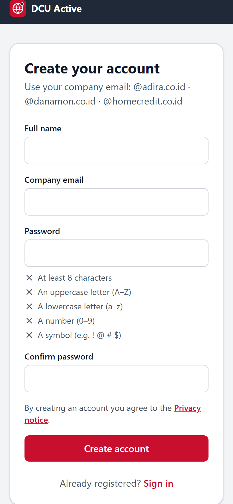

1. Di halaman masuk, pilih **Create an account**.
2. Isi **Full name** dan **Company email**. Hanya email kantor yang diterima: **@danamon.co.id**, **@adira.co.id**, **@homecredit.co.id** (bukan subdomain, bukan Gmail/Yahoo).
3. Buat **Password** yang memenuhi semua syarat: minimal 8 karakter, ada huruf besar, huruf kecil, angka, dan simbol. Tanda ✓ muncul untuk setiap syarat yang sudah terpenuhi.
4. Ulangi password di **Confirm password**, lalu tekan **Create account**.

### 3.2 Verifikasi email

1. Buka email dari **DCU@danamon.co.id** dengan judul konfirmasi akun.
2. Pilih salah satu:
   - Masukkan **kode 6 digit** dari email ke kolom **Verification code**, lalu tekan **Verify**; atau
   - Tekan link di email, lalu tekan **Confirm my email** di halaman yang terbuka.
3. Setelah terverifikasi, Anda bisa masuk dan mulai booking.

> Tidak menerima email? Periksa folder Spam/Junk, tunggu 1 menit, lalu minta kirim ulang. Bila tetap tidak ada, hubungi DCU (lihat bagian 9).

### 3.3 Masuk (Sign in)

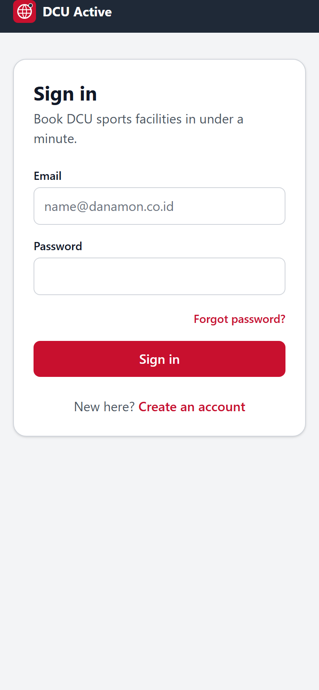

Masukkan **Email** dan **Password**, lalu tekan **Sign in**. Anda akan dibawa ke halaman **Home**.

### 3.4 Lupa password

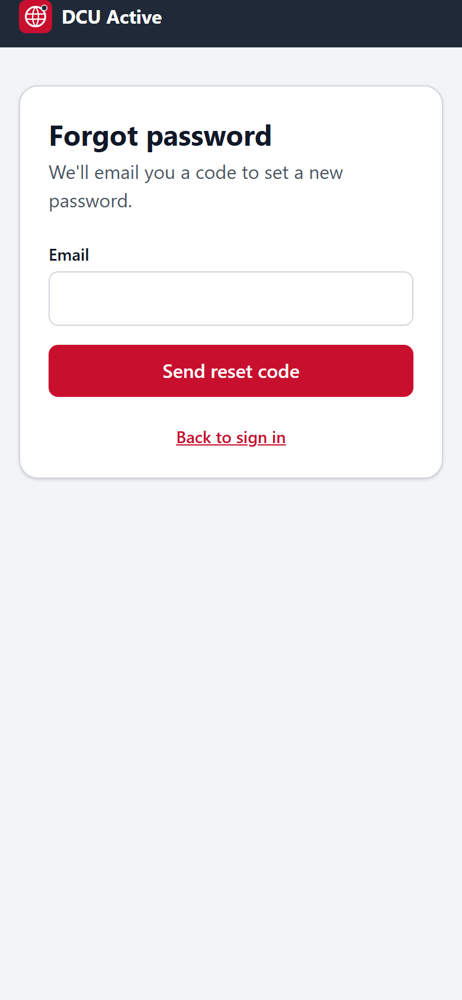

1. Di halaman masuk, pilih **Forgot password?**.
2. Masukkan email Anda lalu tekan **Send reset code**.
3. Masukkan **Reset code** dari email (atau buka link di email), lalu buat password baru.

### 3.5 Keluar (Sign out)

Buka **Profile** → **Sign out**.

## 4. Halaman utama (Home)

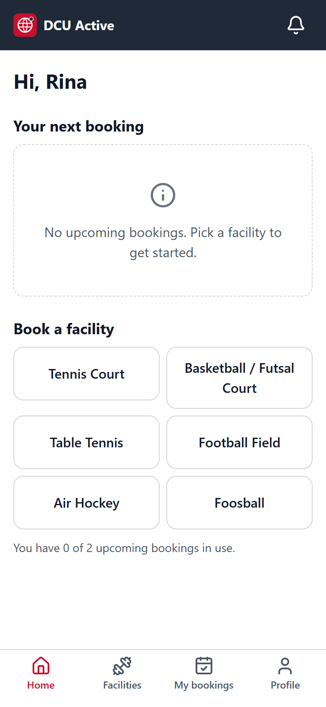

Bagian bawah layar HP berisi menu: **Home**, **Facilities**, **My bookings**, **Profile**. Ikon lonceng di kanan atas membuka **Notifications** (angka merah = notifikasi belum dibaca).

Halaman **Home** menampilkan:
- **Your next booking** — booking terdekat Anda, beserta tombol **Check in now** saat waktunya;
- **Book a facility** — pintasan ke setiap fasilitas;
- jumlah booking aktif Anda, misalnya "You have 0 of 2 upcoming bookings in use".

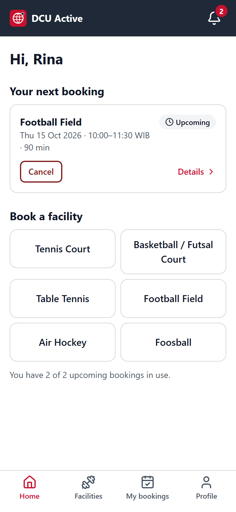

## 5. Membuat booking

### 5.1 Langkah singkat

1. Buka **Facilities** (atau pilih fasilitas di **Home**).
2. Pilih fasilitas.
3. Untuk Basketball / Futsal Court, pilih aktivitas: **Basketball** atau **Futsal**.
4. Pilih **tanggal** di baris Date (Today, Tomorrow, dst.).
5. Ketuk **jam mulai** yang berwarna hijau (**Available**).
6. Untuk Tennis, Court, dan Football, pilih **durasi** di bar bawah: **30 min**, **60 min**, atau **90 min**.
7. Tekan **Review booking**, periksa ringkasannya, lalu tekan **Confirm booking**.

### 5.2 Memilih fasilitas

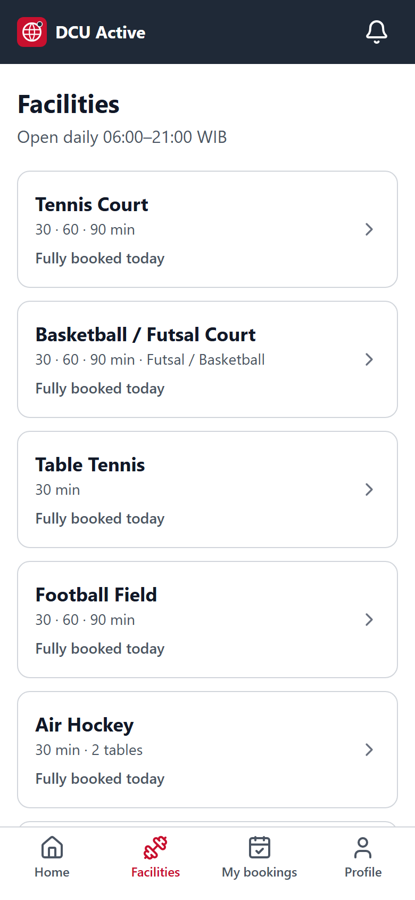

Setiap kartu menampilkan durasi yang tersedia dan petunjuk ketersediaan hari ini (misalnya "Available from 15:30 today" atau "Fully booked today", yang juga muncul setelah jam operasional berakhir). Air Hockey dan Foosball menampilkan jumlah meja.

### 5.3 Memilih tanggal, jam, dan durasi

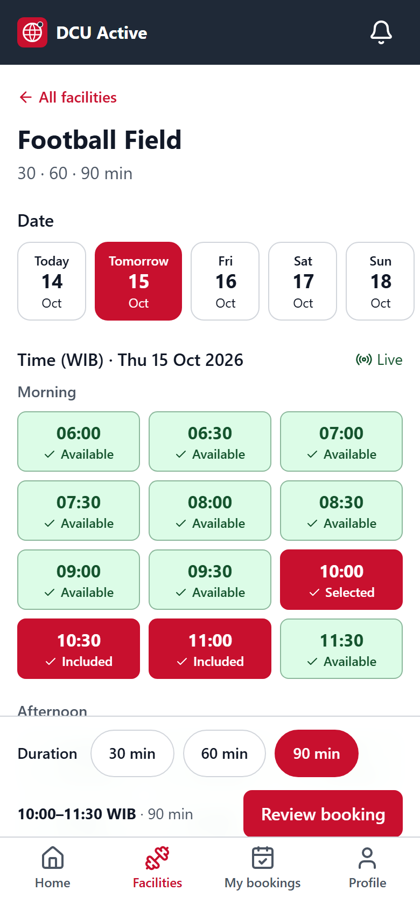

- Label **Live** berarti jadwal diperbarui otomatis bila ada orang lain yang booking.
- Setelah Anda memilih jam dan durasi, **semua kotak yang terpakai ikut ditandai merah**. Contoh pada gambar: mulai 10:00 selama 90 menit, maka 10:00 = **Selected**, 10:30 dan 11:00 = **Included**. Ringkasan di bar bawah menunjukkan **10:00–11:30 WIB · 90 min**.
- Durasi yang tidak muat (karena bertabrakan dengan booking lain atau melewati jam tutup) dicoret dan tidak bisa dipilih.

**Arti tampilan kotak jam:**

| Tampilan | Arti |
|---|---|
| Hijau, **Available** | Bisa dibooking |
| Merah, **Selected** / **Included** | Pilihan Anda (jam mulai / jam yang ikut terpakai) |
| **Booked** atau **Full** | Sudah dibooking orang lain (nama pemesan tidak ditampilkan) |
| **2 left** / **1 left** | Air Hockey / Foosball: jumlah meja yang masih kosong |
| **Your booking** | Booking milik Anda |
| **Unavailable – Maintenance / Event / Operational** | Ditutup oleh DCU |
| **Past** | Jam sudah lewat (sembunyikan/tampilkan dengan **Show earlier times**) |

Untuk Basketball / Futsal Court, pilih aktivitasnya terlebih dahulu:

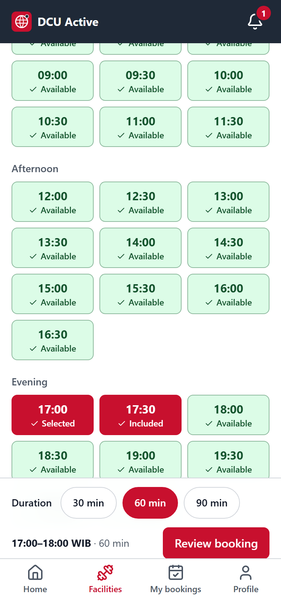

Untuk fasilitas 30 menit (Table Tennis, Air Hockey, Foosball), cukup pilih jam, karena durasinya selalu 30 menit:

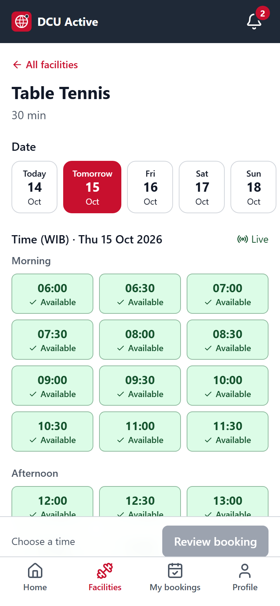

### 5.4 Review dan konfirmasi

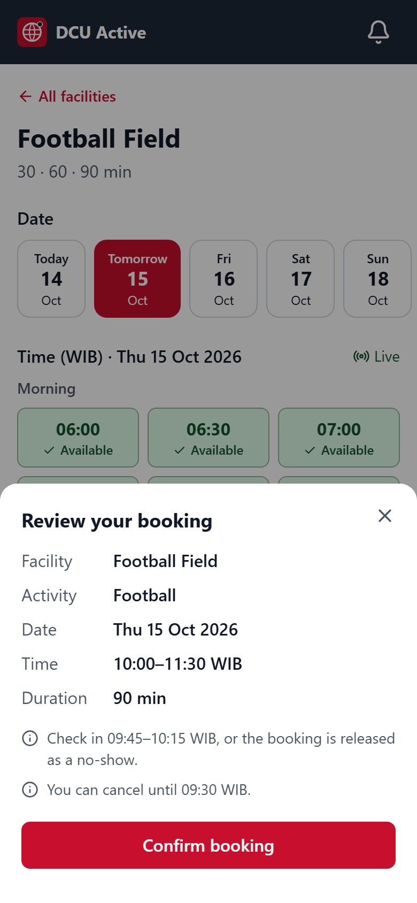

Periksa fasilitas, aktivitas, tanggal, jam, dan durasi. Lembar ini juga menunjukkan jam **check-in** dan batas waktu **pembatalan**. Tekan **Confirm booking**.

> Bila jam tersebut baru saja dibooking orang lain, muncul pesan **"That time was just booked"**. Pilih jam lain. Tidak mungkin terjadi booking ganda.

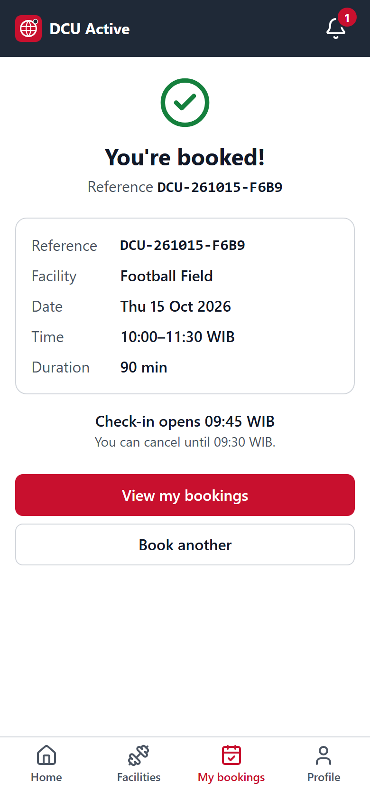

Booking berhasil ditandai dengan **You're booked!** dan **nomor referensi** (mis. DCU-261015-F6B9). Untuk Air Hockey / Foosball, nomor meja juga ditampilkan.

## 6. Mengelola booking

### 6.1 My bookings

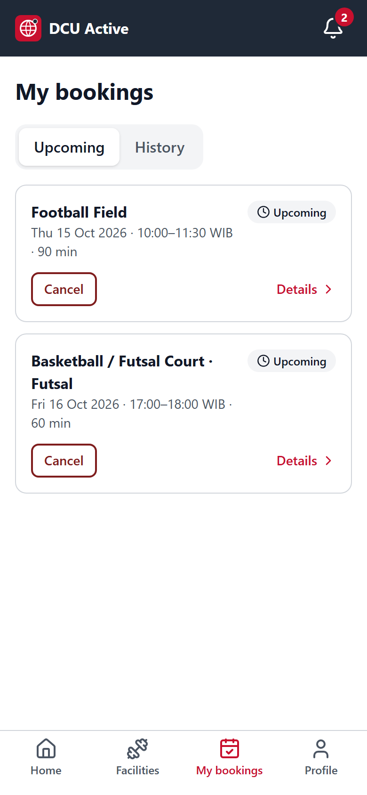

- Tab **Upcoming**: booking yang akan datang, dengan tombol **Check in now** (saat jendela check-in buka), **Cancel**, dan **Details**.
- Tab **History**: booking yang sudah lewat atau dibatalkan.

**Status booking:**

| Status | Arti |
|---|---|
| **Upcoming** | Terkonfirmasi, belum dimulai |
| **Checked in** | Anda sudah check-in |
| **Completed** | Selesai |
| **Cancelled** | Dibatalkan oleh Anda |
| **Cancelled by DCU** | Dibatalkan oleh Admin (alasan ditampilkan), mis. karena perawatan fasilitas |
| **No-show** | Tidak check-in tepat waktu; booking dilepas |

### 6.2 Detail booking

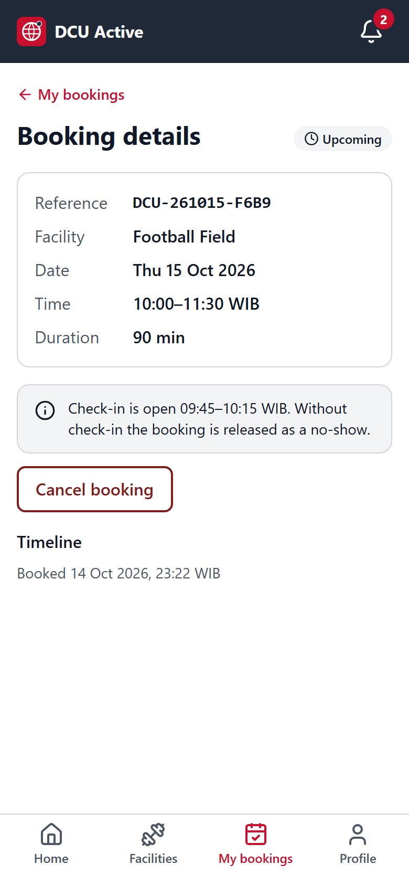

Menampilkan referensi, fasilitas, tanggal, jam, durasi, jendela check-in, tombol aksi, dan riwayat (**Timeline**).

### 6.3 Check-in

1. Datang ke fasilitas.
2. Mulai **15 menit sebelum** jam mulai sampai **15 menit sesudahnya**, tekan **Check in now** di **Home**, **My bookings**, atau detail booking.
3. Muncul pesan **"You're checked in"**.

Bila belum waktunya, aplikasi menampilkan jam dibukanya check-in. Bila sudah lewat 15 menit, check-in ditutup dan booking menjadi **No-show**.

### 6.4 Membatalkan booking

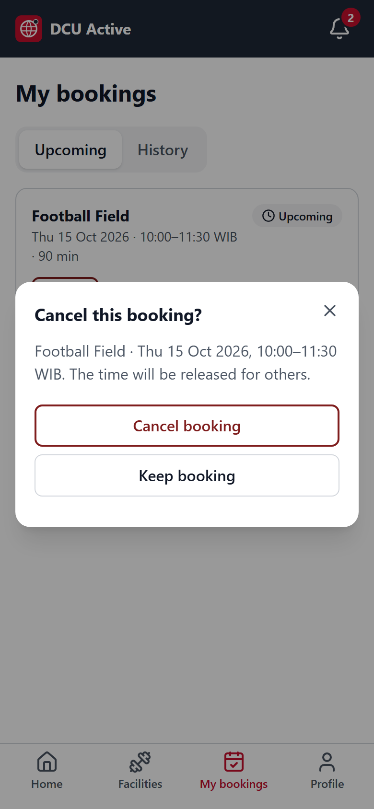

1. Tekan **Cancel** (atau **Cancel booking** di halaman detail).
2. Tekan **Cancel booking** untuk mengonfirmasi, atau **Keep booking** untuk batal membatalkan.

Pembatalan hanya bisa dilakukan paling lambat **30 menit sebelum mulai**. Setelah itu tombol tidak tersedia. Jam yang dibatalkan langsung tersedia untuk orang lain, dan batas "1 booking per fasilitas per hari" untuk hari itu terbuka kembali.

## 7. Notifikasi

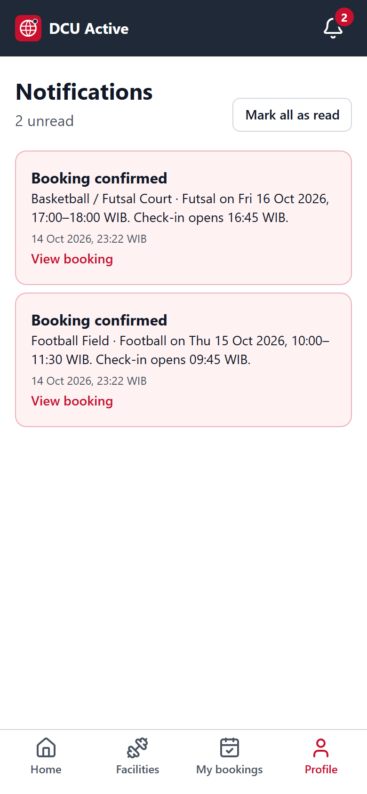

Ketuk ikon lonceng untuk melihat pemberitahuan, misalnya booking terkonfirmasi, booking dibatalkan oleh DCU (beserta alasannya), atau no-show. Tekan **Mark all as read** untuk menandai semua sudah dibaca. Notifikasi disimpan selama 90 hari.

## 8. Profil

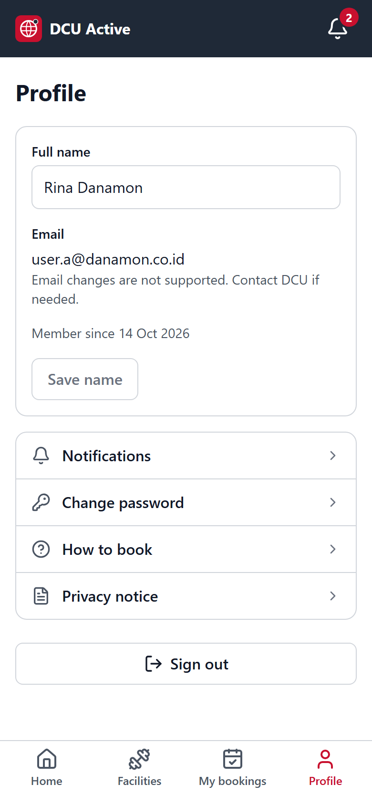

- **Full name:** bisa diubah lalu disimpan dengan **Save name**.
- **Email:** tidak bisa diubah. Hubungi DCU bila perlu.
- **Change password:** isi **New password** dan **Confirm new password** (syarat sama seperti saat mendaftar).
- **How to book:** ringkasan cara booking dan aturan.
- **Privacy notice:** informasi data pribadi apa yang disimpan dan untuk apa.
- **Sign out:** keluar dari aplikasi.

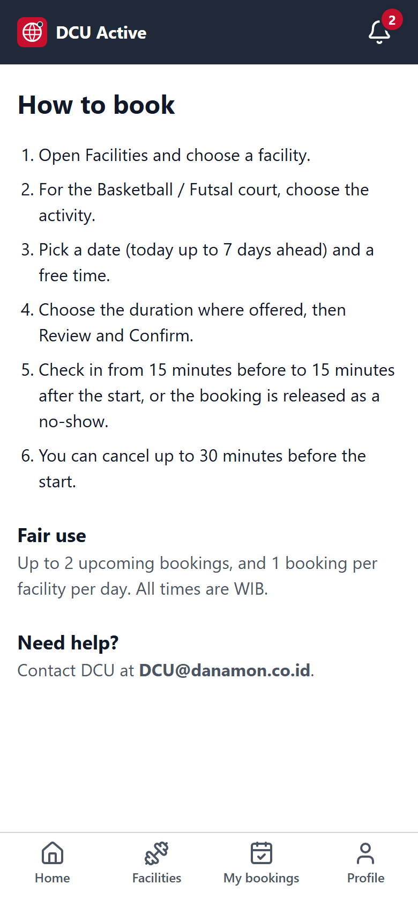

## 9. Pesan yang mungkin muncul

| Pesan | Arti dan yang perlu dilakukan |
|---|---|
| Please register with your company email. | Email bukan domain yang diizinkan. Gunakan email kantor. |
| Email or password is incorrect. | Periksa kembali email/password, atau gunakan **Forgot password?**. |
| Please verify your email first. | Selesaikan verifikasi email (bagian 3.2). |
| That code is invalid or has expired. Request a new one. | Kode salah atau kedaluwarsa (berlaku 60 menit). Minta kode baru. |
| You already have 2 upcoming bookings. Cancel one or wait until one has finished. | Batas 2 booking aktif tercapai. |
| You already have a booking for this facility on that day. | Batas 1 booking per fasilitas per hari. Pilih hari lain atau fasilitas lain. |
| Sorry — that time was just booked or is unavailable. | Jam baru saja diambil orang lain. Pilih jam lain. |
| Bookings can be cancelled up to 30 minutes before the start time. | Batas waktu pembatalan sudah lewat. |
| Check-in opens at …, The check-in window has closed. | Check-in hanya dalam jendela waktunya (bagian 6.3). |
| Your account has been disabled. Please contact DCU. | Akun dinonaktifkan oleh Admin. Hubungi DCU. |
| Too many attempts. Please wait a moment and try again. | Terlalu banyak percobaan. Tunggu sebentar. |

**Butuh bantuan?** Hubungi DCU di **DCU@danamon.co.id**.

---

# Bagian B — Admin DCU

## 10. Masuk ke area Admin

Admin masuk dengan akun yang sama seperti pengguna biasa. Setelah masuk, tombol **Admin** muncul di bagian atas layar. Area Admin paling nyaman dipakai di laptop. Menu di kiri: **Dashboard**, **Bookings**, **Facility blocks**, **Users**, **Settings**, **Audit log**, dan **Back to booking app**.

> Semua perubahan oleh Admin tercatat di **Audit log** dan tidak dapat dihapus. Beberapa aksi wajib disertai **alasan** (minimal 5 karakter).

Admin juga dapat booking untuk dirinya sendiri dengan aturan yang sama seperti pengguna, tetapi tidak dapat booking atas nama orang lain.

## 11. Dashboard

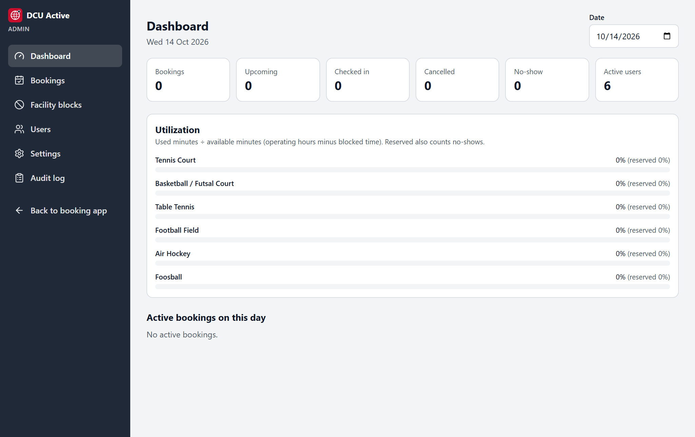

- Pilih **Date** untuk melihat hari tertentu.
- Kartu ringkasan: **Bookings**, **Upcoming**, **Checked in**, **Cancelled**, **No-show**, **Active users**.
- **Utilization** per fasilitas: menit terpakai ÷ menit tersedia (jam operasional dikurangi waktu yang diblokir). Angka **reserved** juga menghitung no-show.
- **Active bookings on this day**: daftar booking aktif pada tanggal itu.

## 12. Bookings

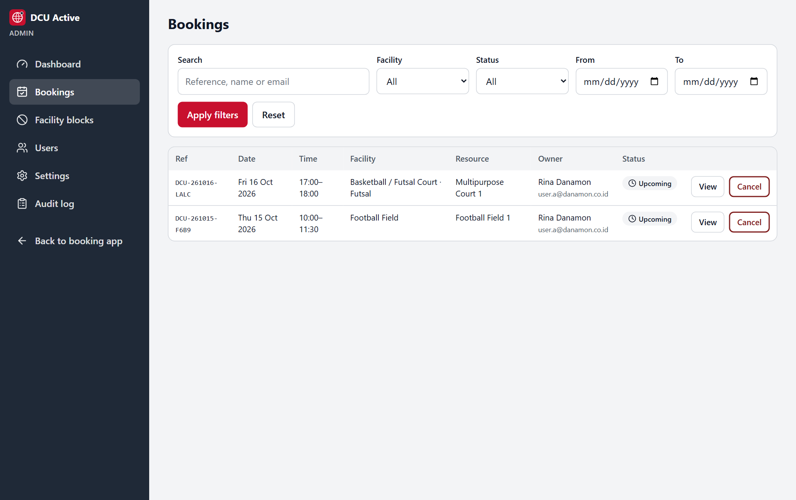

1. Saring dengan **Search** (referensi, nama, atau email), **Facility**, **Status**, serta rentang tanggal **From**–**To**, lalu tekan **Apply filters**.
2. Tekan **View** untuk melihat detail dan riwayat sebuah booking.
3. Untuk membatalkan booking pengguna, tekan **Cancel**, isi **alasan**, lalu konfirmasi. Pemilik booking menerima notifikasi berisi alasan tersebut, dan status booking menjadi **Cancelled by DCU**.

## 13. Facility blocks (menutup fasilitas)

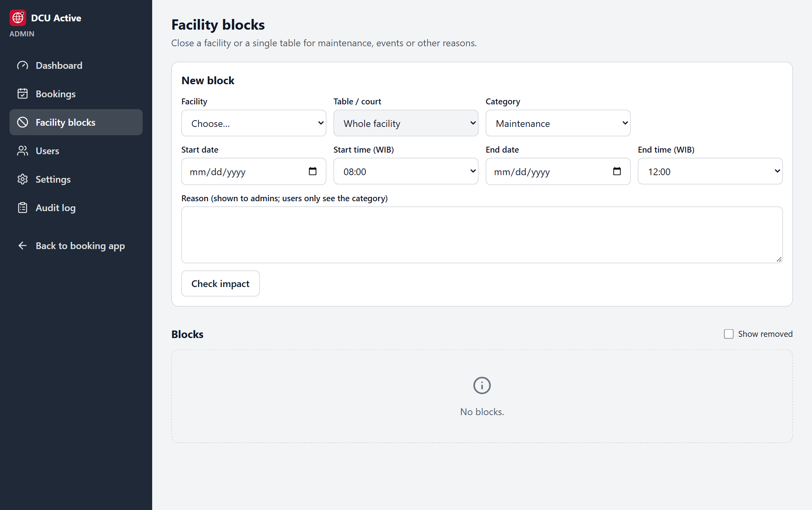

Gunakan fitur ini untuk menutup fasilitas atau satu meja sementara, misalnya karena perawatan atau acara.

1. Pilih **Facility**. Untuk Air Hockey / Foosball, pilih juga **Table / court** (satu meja atau **Whole facility**).
2. Pilih **Category**: Maintenance, Event, atau Operational. Pengguna hanya melihat kategori ini, bukan alasannya.
3. Isi **Start date**, **Start time (WIB)**, **End date**, **End time (WIB)**. Jam mengikuti slot 30 menit, dan blok boleh lebih dari satu hari.
4. Isi **Reason** (hanya terlihat oleh Admin).
5. Tekan **Check impact**. Sistem menampilkan booking yang akan terdampak.
6. Bila ada booking yang bertabrakan, centang konfirmasi bahwa Anda memahami booking tersebut akan dibatalkan, lalu tekan **Create block**. Pemilik booking menerima notifikasi.
7. Blok yang sudah ada tampil di daftar **Blocks** dan dapat dihapus (dengan alasan). Centang **Show removed** untuk melihat blok yang sudah dihapus.

## 14. Users

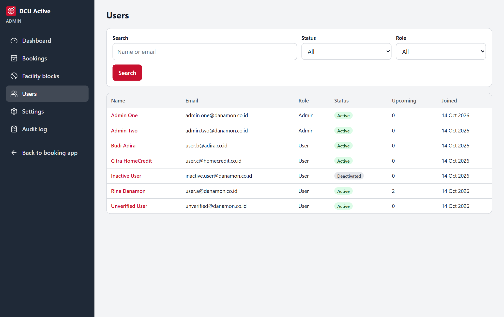

Cari pengguna berdasarkan nama atau email, lalu saring berdasarkan **Status** dan **Role**. Klik nama untuk membuka detailnya.

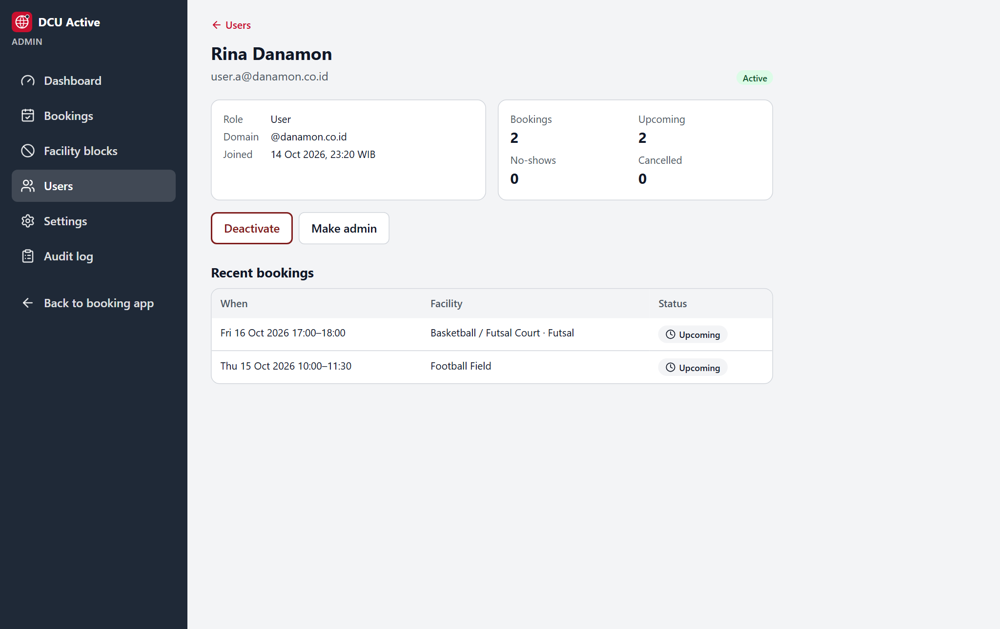

Di halaman detail, Admin dapat:
- **Deactivate** / **Activate** akun. Menonaktifkan akun langsung mencegah pengguna memakai aplikasi, dan semua booking mendatangnya otomatis dibatalkan.
- **Make admin** / **Remove admin**. Hanya untuk email berdomain yang diizinkan.
- Melihat **Recent bookings** dan jumlah no-show pengguna tersebut.

Pengaman sistem:
- Admin tidak dapat menonaktifkan atau menurunkan perannya sendiri.
- Harus selalu ada minimal **1 admin aktif**. Disarankan selalu ada minimal 2 admin.

## 15. Settings

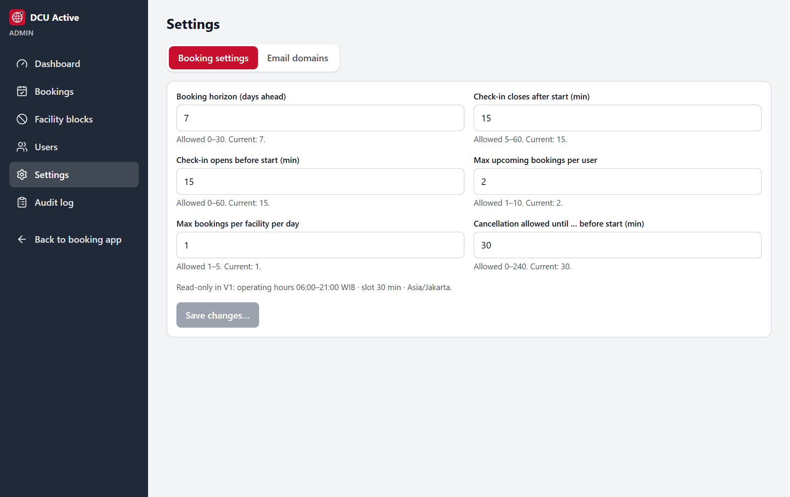

### 15.1 Booking settings

| Pengaturan | Saat ini | Rentang yang diizinkan |
|---|---|---|
| Booking horizon (days ahead) | 7 | 0–30 |
| Check-in opens before start (min) | 15 | 0–60 |
| Check-in closes after start (min) | 15 | 5–60 |
| Max upcoming bookings per user | 2 | 1–10 |
| Max bookings per facility per day | 1 | 1–5 |
| Cancellation allowed until … before start (min) | 30 | 0–240 |

Ubah nilainya, tekan **Save changes…**, isi alasan, lalu konfirmasi. Perubahan berlaku seketika untuk booking dan tindakan berikutnya. Booking yang sudah ada tidak diubah. Jam operasional (06:00–21:00 WIB), panjang slot (30 menit), dan zona waktu bersifat tetap (read-only) di versi 1.

### 15.2 Email domains

Tab **Email domains** mengatur domain email yang boleh mendaftar.
- **Add domain…**: tambahkan domain baru (persis, tanpa subdomain).
- **Rename**: ganti nama domain.
- **Remove**: hapus domain. Pengguna lama dengan domain tersebut **tetap aktif**; hanya pendaftaran baru yang ditolak.
- Minimal harus ada **1 domain** aktif.

## 16. Audit log

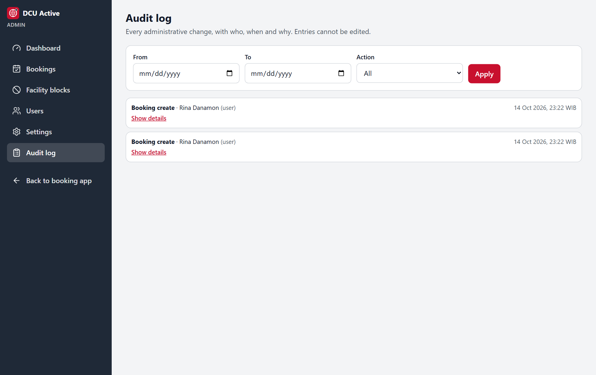

Audit log mencatat siapa melakukan apa, kapan, nilai sebelum/sesudah, dan alasannya, misalnya pembatalan oleh admin, blok, perubahan peran, perubahan pengaturan, dan perubahan domain. Saring berdasarkan rentang tanggal (**From**–**To**) dan jenis **Action**. Catatan ini tidak bisa diubah atau dihapus oleh siapa pun.

## 17. Tips operasional untuk Admin

- Gunakan **Facility blocks** jauh hari untuk perawatan terjadwal, agar pengguna tidak perlu dibatalkan.
- Periksa **Dashboard** secara berkala untuk tingkat no-show dan utilisasi.
- Pastikan selalu ada minimal 2 admin aktif.
- Bila ada akun yang disalahgunakan: **Deactivate** akun tersebut. Booking mendatangnya otomatis dibatalkan dan tercatat di audit log.
